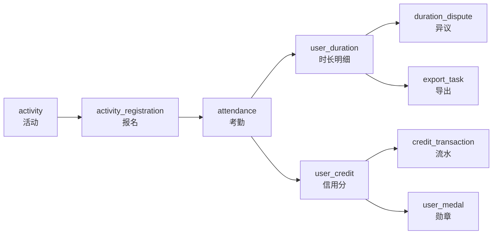

# 数据库设计文档

> **项目版本：** 2.3.0
> **数据库：** MySQL 8.0+ / InnoDB / utf8mb4 / utf8mb4_unicode_ci
> **表数量：** 70 张

本文是「一体式志愿者服务平台」的数据库权威说明。**唯一事实来源是 SQL 脚本本身**：

| 脚本 | 完整路径 | 用途 |
|------|----------|------|
| Flyway 基线迁移 | `volunteer-backend/volunteer-server/src/main/resources/db/migration/V1__baseline_full_schema.sql` | **容器化部署的实际建表路径**，应用启动时自动执行 |
| 手工全量脚本 | `volunteer-backend/volunteer-server/src/main/resources/db/init.sql` | 应急 / 离线场景手工执行，含 `DROP DATABASE` / `CREATE DATABASE` / `USE` |

两份脚本的结构部分必须保持一致（V1 文件头部 `维护约定` 已声明该约束），表结构、索引、外键、CHECK 约束均相同；
差异只在数据库级语句与是否包含 Flyway 元数据表。本文档的表定义全部逐字提取自 `volunteer-backend/volunteer-server/src/main/resources/db/migration/V1__baseline_full_schema.sql`，未做任何转述。

> **注意：本项目的 MySQL 容器没有挂载 `docker-entrypoint-initdb.d`。**
> 使用 `docker-compose.env.yml` 启动时，MySQL 只创建空库 `volunteer_db`，
> **建表完全依赖后端启动时的 Flyway 迁移**（`spring.flyway.enabled=true`、`locations=classpath:db/migration`、`baseline-on-migrate=true`）。
> 迁移链当前**只有 `V1__baseline_full_schema.sql` 一个脚本**，没有 V2 及之后的增量脚本。

---

## 一、数据库总体约定

### 1.1 主键策略

| 层次 | 约定 |
|------|------|
| 数据库 | 业务表主键统一为 `id BIGINT AUTO_INCREMENT PRIMARY KEY` |
| 应用 | 实体统一继承 `BaseEntity`，主键声明为 `@TableId(type = IdType.AUTO)` |

**两者必须保持一致，不可改为 `ASSIGN_ID`（雪花 ID）。** V1 脚本的种子数据依赖自增生成稳定连续主键：
`sys_permission` 种子不含 `id` 列，由自增产生 1..15，下游用 `SELECT 2, id FROM sys_permission WHERE id IN (4, 5, 7)` 引用；
`sys_user_role` / `sys_role_permission` 直接硬编码 `(user_id, role_id)` 组合。
若改用雪花 ID，这些硬编码整数 ID 将无法对应。

### 1.2 通用字段

绝大多数业务表带有审计字段，由 `volunteer-common/src/main/java/com/volunteer/common/config/MyMetaObjectHandler.java` 自动填充：

| 字段 | 类型 | 含义 |
|------|------|------|
| `create_time` | `DATETIME DEFAULT CURRENT_TIMESTAMP` | 创建时间 |
| `update_time` | `DATETIME DEFAULT CURRENT_TIMESTAMP ON UPDATE CURRENT_TIMESTAMP` | 更新时间 |
| `create_by` / `created_by` | `BIGINT` | 创建人（不同脚本命名略有差异，以实际 DDL 为准） |
| `deleted` | `TINYINT DEFAULT 0` | 逻辑删除标记 |

关于 `deleted` 字段的准确分布（逐表核对 V1 后的实测结果）：

- **含 `deleted` 字段的表：23 张** —— 这些表走 MyBatis-Plus 逻辑删除。
- **不含 `deleted` 字段的表：47 张** —— 这些表是物理删除。

### 1.3 命名与类型约定

| 项 | 约定 |
|----|------|
| 表名 | 小写下划线；关联表为 `主_从`（如 `sys_user_role`） |
| 字段名 | 小写下划线；外键为 `xxx_id` 指向 `xxx.id` |
| 状态字段 | 多为 `VARCHAR(32)`，取值由 Java 枚举或字符串字面量控制（见第四章） |
| 金额 / 时长 | `DECIMAL(12,2)`，单位：小时 |
| 坐标 | `DECIMAL(10,7)` 级精度 |
| 布尔语义 | `TINYINT`，`0` 否 / `1` 是 |
| 时间 | `DATETIME`，时区 `Asia/Shanghai`（由 `TZ` 环境变量与 JDBC `serverTimezone` 共同确定） |

### 1.4 代码中不存在 MyBatis XML

**全项目没有任何 `*Mapper.xml`。** 所有 Mapper 均为接口 + MyBatis-Plus 注解
（`@Select` / `@Update` / `@Insert` / `@Delete` 或 `BaseMapper` 内置方法），
文件位于各模块 `src/main/java/com/volunteer/<module>/mapper/`。
因此数据库相关逻辑要读 Java 注解，而不是 XML。

---

## 二、数据模型总览

### 2.1 实体—表映射对照

下表列出源码中显式声明了 `@TableName` 的实体类与其表名的对应关系，这是读代码时最有用的索引之一。

| 实体类 | 表名 | 源文件 |
|--------|------|--------|
| `Activity` | `activity` | `volunteer-backend/volunteer-activity/src/main/java/com/volunteer/activity/entity/Activity.java` |
| `ActivityChangeLog` | `activity_change_log` | `volunteer-backend/volunteer-activity/src/main/java/com/volunteer/activity/entity/ActivityChangeLog.java` |
| `ActivityConflictCheck` | `activity_conflict_check` | `volunteer-backend/volunteer-report/src/main/java/com/volunteer/report/entity/ActivityConflictCheck.java` |
| `ActivityHealth` | `activity_health` | `volunteer-backend/volunteer-report/src/main/java/com/volunteer/report/entity/ActivityHealth.java` |
| `ActivityImportLog` | `activity_import_log` | `volunteer-backend/volunteer-activity/src/main/java/com/volunteer/activity/entity/ActivityImportLog.java` |
| `ActivityMetric` | `activity_metric` | `volunteer-backend/volunteer-report/src/main/java/com/volunteer/report/entity/ActivityMetric.java` |
| `ActivityPreference` | `activity_preference` | `volunteer-backend/volunteer-report/src/main/java/com/volunteer/report/entity/ActivityPreference.java` |
| `ActivityRegistration` | `activity_registration` | `volunteer-backend/volunteer-activity/src/main/java/com/volunteer/activity/entity/ActivityRegistration.java` |
| `ActivityReview` | `activity_review` | `volunteer-backend/volunteer-report/src/main/java/com/volunteer/report/entity/ActivityReview.java` |
| `ActivityTemplate` | `activity_template` | `volunteer-backend/volunteer-activity/src/main/java/com/volunteer/activity/entity/ActivityTemplate.java` |
| `Attendance` | `attendance` | `volunteer-backend/volunteer-attendance/src/main/java/com/volunteer/attendance/entity/Attendance.java` |
| `Certification` | `certification` | `volunteer-backend/volunteer-report/src/main/java/com/volunteer/report/entity/Certification.java` |
| `CertificationApplication` | `certification_application` | `volunteer-backend/volunteer-report/src/main/java/com/volunteer/report/entity/CertificationApplication.java` |
| `Commendation` | `commendation` | `volunteer-backend/volunteer-report/src/main/java/com/volunteer/report/entity/Commendation.java` |
| `CourseImportLog` | `course_import_log` | `volunteer-backend/volunteer-report/src/main/java/com/volunteer/report/entity/CourseImportLog.java` |
| `CourseSchedule` | `course_schedule` | `volunteer-backend/volunteer-report/src/main/java/com/volunteer/report/entity/CourseSchedule.java` |
| `CreditOrder` | `credit_order` | `volunteer-backend/volunteer-report/src/main/java/com/volunteer/report/entity/CreditOrder.java` |
| `CreditProduct` | `credit_product` | `volunteer-backend/volunteer-report/src/main/java/com/volunteer/report/entity/CreditProduct.java` |
| `CreditTransaction` | `credit_transaction` | `volunteer-backend/volunteer-report/src/main/java/com/volunteer/report/entity/CreditTransaction.java` |
| `DailyTask` | `daily_task` | `volunteer-backend/volunteer-report/src/main/java/com/volunteer/report/entity/DailyTask.java` |
| `DiagnosisReport` | `diagnosis_report` | `volunteer-backend/volunteer-report/src/main/java/com/volunteer/report/entity/DiagnosisReport.java` |
| `DurationDispute` | `duration_dispute` | `volunteer-backend/volunteer-report/src/main/java/com/volunteer/report/entity/DurationDispute.java` |
| `ExportTask` | `export_task` | `volunteer-backend/volunteer-report/src/main/java/com/volunteer/report/entity/ExportTask.java` |
| `ExternalPlatformDuration` | `external_platform_duration` | `volunteer-backend/volunteer-report/src/main/java/com/volunteer/report/entity/ExternalPlatformDuration.java` |
| `Feedback` | `feedback` | `volunteer-backend/volunteer-report/src/main/java/com/volunteer/report/entity/Feedback.java` |
| `ImprovementSuggestion` | `improvement_suggestion` | `volunteer-backend/volunteer-report/src/main/java/com/volunteer/report/entity/ImprovementSuggestion.java` |
| `Medal` | `medal` | `volunteer-backend/volunteer-report/src/main/java/com/volunteer/report/entity/Medal.java` |
| `MessageTemplate` | `message_template` | `volunteer-backend/volunteer-common/src/main/java/com/volunteer/common/entity/MessageTemplate.java` |
| `PopularActivity` | `popular_activity` | `volunteer-backend/volunteer-report/src/main/java/com/volunteer/report/entity/PopularActivity.java` |
| `Recommendation` | `recommendation` | `volunteer-backend/volunteer-report/src/main/java/com/volunteer/report/entity/Recommendation.java` |
| `RecommendationLog` | `recommendation_log` | `volunteer-backend/volunteer-report/src/main/java/com/volunteer/report/entity/RecommendationLog.java` |
| `ServiceStation` | `service_station` | `volunteer-backend/volunteer-report/src/main/java/com/volunteer/report/entity/ServiceStation.java` |
| `Skill` | `skill` | `volunteer-backend/volunteer-report/src/main/java/com/volunteer/report/entity/Skill.java` |
| `SkillCategory` | `skill_category` | `volunteer-backend/volunteer-report/src/main/java/com/volunteer/report/entity/SkillCategory.java` |
| `SkillMatching` | `skill_matching` | `volunteer-backend/volunteer-report/src/main/java/com/volunteer/report/entity/SkillMatching.java` |
| `SysOperationLog` | `sys_operation_log` | `volunteer-backend/volunteer-common/src/main/java/com/volunteer/common/entity/SysOperationLog.java` |
| `SysOrganization` | `sys_organization` | `volunteer-backend/volunteer-auth/src/main/java/com/volunteer/auth/entity/SysOrganization.java` |
| `SysPermission` | `sys_permission` | `volunteer-backend/volunteer-auth/src/main/java/com/volunteer/auth/entity/SysPermission.java` |
| `SysRole` | `sys_role` | `volunteer-backend/volunteer-auth/src/main/java/com/volunteer/auth/entity/SysRole.java` |
| `SysRolePermission` | `sys_role_permission` | `volunteer-backend/volunteer-auth/src/main/java/com/volunteer/auth/entity/SysRolePermission.java` |
| `SysUser` | `sys_user` | `volunteer-backend/volunteer-auth/src/main/java/com/volunteer/auth/entity/SysUser.java` |
| `SysUserRole` | `sys_user_role` | `volunteer-backend/volunteer-auth/src/main/java/com/volunteer/auth/entity/SysUserRole.java` |
| `SystemAnnouncement` | `system_announcement` | `volunteer-backend/volunteer-notification/src/main/java/com/volunteer/notification/entity/SystemAnnouncement.java` |
| `SystemConfig` | `system_config` | `volunteer-backend/volunteer-report/src/main/java/com/volunteer/report/entity/SystemConfig.java` |
| `Team` | `team` | `volunteer-backend/volunteer-activity/src/main/java/com/volunteer/activity/entity/Team.java` |
| `TeamMember` | `team_member` | `volunteer-backend/volunteer-activity/src/main/java/com/volunteer/activity/entity/TeamMember.java` |
| `TimeBankAccount` | `time_bank_account` | `volunteer-backend/volunteer-report/src/main/java/com/volunteer/report/entity/TimeBankAccount.java` |
| `TimeBankServiceEntity` | `time_bank_service` | `volunteer-backend/volunteer-report/src/main/java/com/volunteer/report/entity/TimeBankServiceEntity.java` |
| `TimeBankTransaction` | `time_bank_transaction` | `volunteer-backend/volunteer-report/src/main/java/com/volunteer/report/entity/TimeBankTransaction.java` |
| `TimeSlotConfig` | `time_slot_config` | `volunteer-backend/volunteer-report/src/main/java/com/volunteer/report/entity/TimeSlotConfig.java` |
| `TrainingCourse` | `training_course` | `volunteer-backend/volunteer-report/src/main/java/com/volunteer/report/entity/TrainingCourse.java` |
| `TrainingRecord` | `training_record` | `volunteer-backend/volunteer-report/src/main/java/com/volunteer/report/entity/TrainingRecord.java` |
| `UserCredit` | `user_credit` | `volunteer-backend/volunteer-report/src/main/java/com/volunteer/report/entity/UserCredit.java` |
| `UserDuration` | `user_duration` | `volunteer-backend/volunteer-report/src/main/java/com/volunteer/report/entity/UserDuration.java` |
| `UserMedal` | `user_medal` | `volunteer-backend/volunteer-report/src/main/java/com/volunteer/report/entity/UserMedal.java` |
| `UserMessage` | `user_message` | `volunteer-backend/volunteer-notification/src/main/java/com/volunteer/notification/entity/UserMessage.java` |
| `UserProfile` | `user_profile` | `volunteer-backend/volunteer-report/src/main/java/com/volunteer/report/entity/UserProfile.java` |
| `UserSkill` | `user_skill` | `volunteer-backend/volunteer-report/src/main/java/com/volunteer/report/entity/UserSkill.java` |
| `UserTaskRecord` | `user_task_record` | `volunteer-backend/volunteer-report/src/main/java/com/volunteer/report/entity/UserTaskRecord.java` |
| `UserTodo` | `user_todo` | `volunteer-backend/volunteer-report/src/main/java/com/volunteer/report/entity/UserTodo.java` |
| `ViolationRecord` | `violation_record` | `volunteer-backend/volunteer-attendance/src/main/java/com/volunteer/attendance/entity/ViolationRecord.java` |
| `VolunteerReview` | `volunteer_review` | `volunteer-backend/volunteer-report/src/main/java/com/volunteer/report/entity/VolunteerReview.java` |
| `WeekConfig` | `week_config` | `volunteer-backend/volunteer-report/src/main/java/com/volunteer/report/entity/WeekConfig.java` |

**有 7 张表在 Java 侧没有对应的实体类 / Mapper**，逐表核对结果如下 —— 读代码时不要试图去找它们的 Entity：

| 表名 | 状态 | 说明 |
|------|------|------|
| `activity_category` | 仅裸 SQL 读取 | 无实体类；`volunteer-activity/src/main/java/com/volunteer/activity/service/ActivityService.java:1067` 直接 `SELECT COUNT(1) FROM activity_category WHERE category_code = ? AND COALESCE(status, 1) = 1` |
| `evaluation_activity` | 无代码引用 | 全量 `src/main/java` 未出现该表名；当前活动评价走 `activity_review` |
| `evaluation_volunteer` | 无代码引用 | 全量 `src/main/java` 未出现该表名；当前志愿者互评走 `volunteer_review` |
| `ai_conversation` | 无代码引用 | 全量 `src/main/java` 未出现该表名；AI 对话当前不落库 |
| `knowledge_base` | 无代码引用 | 全量 `src/main/java` 未出现该表名；知识库当前为内存态实现 |
| `certificate_sequence` | 无代码引用 | 全量 `src/main/java` 未出现该表名；证书编号当前不走该序列表 |
| `shedlock` | 基础设施表 | 由 ShedLock 的 `JdbcTemplateLockProvider` 直接读写，`withTableName("shedlock")`，无实体类 |

前 6 张是结构先行、实现未跟上（或已改走新表）的历史表：**表在库里，代码不用**。它们不影响运行，但重置数据库时会被一并创建。

### 2.2 核心表关系图

只画主链路（约 40 条关键外键），完整的 87 条外键在各表的「外键」小节中逐条列出。

```mermaid
erDiagram
    sys_organization ||--o{ sys_user : ""
    sys_user ||--o{ sys_user_role : ""
    sys_role ||--o{ sys_user_role : ""
    sys_role ||--o{ sys_role_permission : ""
    sys_permission ||--o{ sys_role_permission : ""
    sys_user ||--o{ user_profile : ""
    activity_category ||--o{ activity : ""
    sys_user ||--o{ activity : ""
    sys_organization ||--o{ activity : ""
    activity ||--o{ activity_registration : ""
    sys_user ||--o{ activity_registration : ""
    activity ||--o{ team : ""
    team ||--o{ team_member : ""
    sys_user ||--o{ team_member : ""
    activity ||--o{ activity_change_log : ""
    activity_template ||--o{ activity : ""
    activity ||--o{ activity_import_log : ""
    activity ||--o{ attendance : ""
    sys_user ||--o{ attendance : ""
    sys_user ||--o{ user_duration : ""
    activity ||--o{ user_duration : ""
    attendance ||--o{ user_duration : ""
    user_duration ||--o{ duration_dispute : ""
    sys_user ||--o{ user_message : ""
    activity ||--o{ evaluation_activity : ""
    sys_user ||--o{ evaluation_activity : ""
    sys_user ||--o{ evaluation_volunteer : ""
    sys_user ||--o{ commendation : ""
    sys_user ||--o{ ai_conversation : ""
    sys_user ||--o{ user_credit : ""
    user_credit ||--o{ credit_transaction : ""
    sys_user ||--o{ credit_transaction : ""
    medal ||--o{ user_medal : ""
    sys_user ||--o{ user_medal : ""
    daily_task ||--o{ user_task_record : ""
    sys_user ||--o{ user_task_record : ""
    sys_user ||--o{ user_todo : ""
    credit_product ||--o{ credit_order : ""
    sys_user ||--o{ credit_order : ""
    skill_category ||--o{ skill : ""
    skill ||--o{ user_skill : ""
    sys_user ||--o{ user_skill : ""
    sys_user ||--o{ certification_application : ""
    activity ||--o{ skill_matching : ""
    sys_user ||--o{ activity_preference : ""
    activity ||--o{ recommendation : ""
    sys_user ||--o{ recommendation : ""
    activity ||--o{ activity_health : ""
    activity ||--o{ activity_metric : ""
    activity_health ||--o{ diagnosis_report : ""
    diagnosis_report ||--o{ improvement_suggestion : ""
    sys_user ||--o{ course_schedule : ""
    time_slot_config ||--o{ course_schedule : ""
    sys_user ||--o{ course_import_log : ""
    sys_user ||--o{ activity_conflict_check : ""
    activity ||--o{ activity_conflict_check : ""
    course_schedule ||--o{ activity_conflict_check : ""
    activity ||--o{ external_platform_duration : ""
    sys_user ||--o{ external_platform_duration : ""
    sys_user ||--o{ time_bank_account : ""
    sys_user ||--o{ time_bank_transaction : ""
    training_course ||--o{ training_record : ""
    sys_user ||--o{ training_record : ""
    training_course ||--o{ certification : ""
    sys_user ||--o{ certification : ""
    sys_user ||--o{ activity_review : ""
    activity ||--o{ activity_review : ""
    sys_user ||--o{ volunteer_review : ""
    sys_user ||--o{ feedback : ""
    activity ||--o{ violation_record : ""
    sys_user ||--o{ violation_record : ""
```



### 2.3 核心数据流转

这是理解本项目最重要的链条 —— 一笔志愿服务从发布到沉淀为数据的完整路径：



| 环节 | 写在哪张表 | 触发代码 |
|------|-----------|----------|
| 报名 | `activity_registration`，状态 `PENDING`（需审批）或 `APPROVED`（免审批） | `volunteer-activity/src/main/java/com/volunteer/activity/service/ActivityService.java` |
| 名额占用 | `activity.current_participants` 原子自增 | `ActivityMapper.increaseParticipantsWithLock` |
| 签到 / 签退 | `attendance`，签退后 `duration_hours` + 状态 `PENDING_AUDIT` | `volunteer-attendance/src/main/java/com/volunteer/attendance/service/AttendanceService.java` |
| 时长审核 | `attendance.status` → `APPROVED`（可覆盖 `duration_hours`） | `volunteer-attendance/src/main/java/com/volunteer/attendance/controller/DurationController.java` |
| 时长汇总 | `user_duration`（含 `original_duration` / `adjusted_duration`） | 审核通过后的事件监听链路 |
| 信用分 | `user_credit` + `credit_transaction`（增量 `EARN` / 扣减 `CONSUME`） | `volunteer-report/src/main/java/com/volunteer/report/service/CreditService.java` |
| 勋章解锁 | `user_medal` | `CreditService.checkMedalUnlock` |
| 报表 | 聚合查询 `attendance` / `user_duration`，不落冗余汇总表 | `volunteer-report/.../service/ReportService.java`、`ReportSummaryService.java` |

### 2.4 外键总量分布

| 模块 | 表数 | 字段数 | 索引数 | 外键数 | CHECK 数 |
|------|------|--------|--------|--------|----------|
| 模块 | 表数 | 字段数 | 索引数 | 外键数 | CHECK 数 |
|------|------|--------|--------|--------|----------|
| 系统管理 | 6 | 85 | 22 | 5 | 2 |
| 活动管理 | 8 | 150 | 42 | 15 | 6 |
| 考勤管理 | 2 | 39 | 17 | 6 | 13 |
| 时长管理 | 2 | 37 | 10 | 4 | 1 |
| 消息中心 | 1 | 19 | 6 | 1 | 0 |
| 评价管理 | 2 | 24 | 10 | 5 | 2 |
| 表彰奖励 | 1 | 16 | 2 | 1 | 0 |
| AI | 2 | 22 | 8 | 1 | 0 |
| 系统配置 | 3 | 33 | 5 | 1 | 0 |
| GIS 志愿地图 | 1 | 12 | 0 | 0 | 0 |
| 操作审计日志 | 1 | 13 | 3 | 0 | 0 |
| 信用成长银行 | 9 | 109 | 24 | 9 | 2 |
| 技能认证 | 5 | 56 | 12 | 7 | 0 |
| 智能推荐 | 5 | 44 | 10 | 7 | 0 |
| 活动健康诊断 | 4 | 36 | 10 | 4 | 0 |
| 课程表系统 | 5 | 53 | 11 | 4 | 1 |
| 扩展业务表 | 12 | 141 | 37 | 17 | 6 |
| 分布式锁 | 1 | 4 | 0 | 0 | 0 |
| **合计** | **70** | **893** | **229** | **87** | **33** |

---

## 三、表结构明细

以下按 V1 脚本中的模块顺序逐表列出。字段顺序、类型、默认值、注释均与 DDL 一致。

### 3.1 系统管理（6 张表）

| 表名 | 中文名 | 字段数 |
|------|--------|--------|
| [`sys_organization`](#sys-organization) | 组织信息表 | 15 |
| [`sys_user`](#sys-user) | 用户信息表 | 36 |
| [`sys_role`](#sys-role) | 角色表 | 9 |
| [`sys_user_role`](#sys-user-role) | 用户角色关联表 | 6 |
| [`sys_permission`](#sys-permission) | 权限表 | 13 |
| [`sys_role_permission`](#sys-role-permission) | 角色权限关联表 | 6 |

#### `sys_organization` — 组织信息表

引擎 `InnoDB`　字符集 `utf8mb4`　实体 `SysOrganization`

来源：`volunteer-backend/volunteer-server/src/main/resources/db/migration/V1__baseline_full_schema.sql:76`

| 字段 | 类型 | 允许空 | 默认值 | 说明 |
|------|------|--------|--------|------|
| `id` | BIGINT | YES | — | 主键ID（AUTO_INCREMENT） |
| `organization_name` | VARCHAR(128) | NO | — | 组织名称 |
| `organization_code` | VARCHAR(64) | YES | — | 组织代码 |
| `organization_type` | VARCHAR(32) | YES | 'COLLEGE' | 组织类型: COLLEGE-学院, ASSOCIATION-协会, DEPARTMENT-部门 |
| `parent_id` | BIGINT | YES | — | 父组织ID |
| `leader_id` | BIGINT | YES | — | 负责人ID |
| `contact_phone` | VARCHAR(32) | YES | — | 联系电话 |
| `description` | TEXT | YES | — | 组织描述 |
| `status` | TINYINT | YES | 1 | 状态: 0-禁用, 1-正常 |
| `total_volunteers` | INT | YES | 0 | 志愿者总数 |
| `total_duration` | DECIMAL(12,2) | YES | 0 | 总服务时长(小时) |
| `sort_order` | TINYINT | YES | 0 | 排序号 |
| `create_time` | DATETIME | YES | CURRENT_TIMESTAMP | 创建时间 |
| `update_time` | DATETIME | YES | CURRENT_TIMESTAMP | 更新时间（ON UPDATE） |
| `deleted` | TINYINT(1) | YES | 0 | 删除标记: 0-未删除, 1-已删除 |

**索引**

- `INDEX idx_organization_parent (parent_id)`
- `INDEX idx_organization_status (status)`
- `INDEX idx_org_type (organization_type)`


#### `sys_user` — 用户信息表

引擎 `InnoDB`　字符集 `utf8mb4`　实体 `SysUser`

来源：`volunteer-backend/volunteer-server/src/main/resources/db/migration/V1__baseline_full_schema.sql:99`

| 字段 | 类型 | 允许空 | 默认值 | 说明 |
|------|------|--------|--------|------|
| `id` | BIGINT | YES | — | 主键ID（AUTO_INCREMENT） |
| `username` | VARCHAR(64) | NO | — | 用户名 |
| `password` | VARCHAR(256) | NO | — | 密码(BCrypt加密) |
| `real_name` | VARCHAR(64) | NO | — | 真实姓名 |
| `id_card` | VARCHAR(256) | YES | — | 身份证号(AES-256加密) |
| `phone` | VARCHAR(32) | YES | — | 手机号 |
| `email` | VARCHAR(128) | YES | — | 邮箱 |
| `avatar` | VARCHAR(512) | YES | — | 头像URL |
| `organization_id` | BIGINT | YES | — | 组织ID |
| `college_id` | BIGINT | YES | — | 学院ID（对组织者必填） |
| `college_name` | VARCHAR(128) | YES | — | 学院名称 |
| `major` | VARCHAR(64) | YES | — | 专业 |
| `class_name` | VARCHAR(64) | YES | — | 班级 |
| `grade` | VARCHAR(20) | YES | — | 年级 |
| `student_no` | VARCHAR(32) | YES | — | 学号 |
| `role_code` | VARCHAR(64) | YES | — | 角色代码 |
| `access_level` | TINYINT | YES | 0 | 访问级别: 0-管理员, 1-组织者, 2-完整用户, 3-访客 |
| `gender` | CHAR(1) | YES | — | 性别 M/F |
| `birth_date` | DATE | YES | — | 出生日期 |
| `political_status` | VARCHAR(20) | YES | — | 政治面貌 |
| `emergency_contact` | VARCHAR(64) | YES | — | 紧急联系人 |
| `emergency_phone` | VARCHAR(32) | YES | — | 紧急联系电话 |
| `dorm_area` | VARCHAR(128) | YES | — | 宿舍区域 |
| `service_category_tags` | VARCHAR(255) | YES | — | 服务类别标签 JSON数组 |
| `profile_complete` | TINYINT | YES | 0 | 档案完整度 0-未完成 1-已完成 |
| `volunteer_star_level` | TINYINT | YES | 0 | 星级志愿者 1-5星 |
| `status` | TINYINT | YES | 1 | 状态: 0-禁用, 1-正常, 2-锁定 |
| `last_login_time` | DATETIME | YES | — | 最后登录时间 |
| `last_login_ip` | VARCHAR(64) | YES | — | 最后登录IP |
| `total_duration` | DECIMAL(10,2) | YES | 0 | 总服务时长(小时) |
| `credit_score` | TINYINT UNSIGNED | YES | 100 | 信用分 0-100 |
| `created_by` | BIGINT | YES | — | 创建人 |
| `create_time` | DATETIME | YES | CURRENT_TIMESTAMP | 创建时间 |
| `updated_by` | BIGINT | YES | — | 更新人 |
| `update_time` | DATETIME | YES | CURRENT_TIMESTAMP | 更新时间（ON UPDATE） |
| `deleted` | TINYINT(1) | YES | 0 | 删除标记: 0-未删除, 1-已删除 |

**索引**

- `INDEX idx_user_status (status, deleted)`
- `INDEX idx_user_organization (organization_id)`
- `INDEX idx_user_college (college_name)`
- `INDEX idx_user_phone (phone)`
- `INDEX idx_user_student_no (student_no)`
- `INDEX idx_user_create_time (create_time)`
- `INDEX idx_user_college_id (college_id)`
- `INDEX idx_user_access_level (access_level)`

**外键**

- `CONSTRAINT fk_user_college FOREIGN KEY (college_id) REFERENCES sys_organization(id) ON DELETE SET NULL`

**CHECK 约束**

- `CONSTRAINT chk_user_status CHECK (status IN (0, 1, 2))`
- `CONSTRAINT chk_credit_score CHECK (credit_score BETWEEN 0 AND 100)`


#### `sys_role` — 角色表

引擎 `InnoDB`　字符集 `utf8mb4`　实体 `SysRole`

来源：`volunteer-backend/volunteer-server/src/main/resources/db/migration/V1__baseline_full_schema.sql:153`

| 字段 | 类型 | 允许空 | 默认值 | 说明 |
|------|------|--------|--------|------|
| `id` | BIGINT | YES | — | 主键ID（AUTO_INCREMENT） |
| `role_name` | VARCHAR(64) | NO | — | 角色名称 |
| `role_code` | VARCHAR(64) | NO | — | 角色代码 |
| `description` | VARCHAR(512) | YES | — | 角色描述 |
| `status` | TINYINT | YES | 1 | 状态: 0-禁用, 1-正常 |
| `sort_order` | TINYINT | YES | 0 | 排序号 |
| `create_time` | DATETIME | YES | CURRENT_TIMESTAMP | 创建时间 |
| `update_time` | DATETIME | YES | CURRENT_TIMESTAMP | 更新时间（ON UPDATE） |
| `deleted` | TINYINT(1) | YES | 0 | 删除标记: 0-未删除, 1-已删除 |

**索引**

- `INDEX idx_role_status (status)`
- `INDEX idx_role_code (role_code)`


#### `sys_user_role` — 用户角色关联表

引擎 `InnoDB`　字符集 `utf8mb4`　实体 `SysUserRole`

来源：`volunteer-backend/volunteer-server/src/main/resources/db/migration/V1__baseline_full_schema.sql:169`

| 字段 | 类型 | 允许空 | 默认值 | 说明 |
|------|------|--------|--------|------|
| `id` | BIGINT | YES | — | 主键ID（AUTO_INCREMENT） |
| `user_id` | BIGINT | NO | — | 用户ID |
| `role_id` | BIGINT | NO | — | 角色ID |
| `create_time` | DATETIME | YES | CURRENT_TIMESTAMP | 创建时间 |
| `update_time` | DATETIME | YES | CURRENT_TIMESTAMP | 更新时间（ON UPDATE） |
| `deleted` | TINYINT(1) | YES | 0 | 删除标记：0-未删除，1-已删除 |

**索引**

- `UNIQUE KEY uk_user_role (user_id, role_id)`
- `INDEX idx_sys_user_role_user (user_id)`
- `INDEX idx_sys_user_role_role (role_id)`

**外键**

- `CONSTRAINT fk_user_role_user FOREIGN KEY (user_id) REFERENCES sys_user(id) ON DELETE CASCADE`
- `CONSTRAINT fk_user_role_role FOREIGN KEY (role_id) REFERENCES sys_role(id) ON DELETE CASCADE`


#### `sys_permission` — 权限表

引擎 `InnoDB`　字符集 `utf8mb4`　实体 `SysPermission`

来源：`volunteer-backend/volunteer-server/src/main/resources/db/migration/V1__baseline_full_schema.sql:185`

| 字段 | 类型 | 允许空 | 默认值 | 说明 |
|------|------|--------|--------|------|
| `id` | BIGINT | YES | — | 主键ID（AUTO_INCREMENT） |
| `parent_id` | BIGINT | YES | 0 | 父权限ID |
| `permission_name` | VARCHAR(64) | NO | — | 权限名称 |
| `permission_code` | VARCHAR(128) | NO | — | 权限代码 |
| `permission_type` | TINYINT | NO | — | 权限类型: 1-菜单, 2-按钮, 3-接口 |
| `path` | VARCHAR(256) | YES | — | 路由路径 |
| `component` | VARCHAR(256) | YES | — | 组件路径 |
| `icon` | VARCHAR(64) | YES | — | 图标 |
| `sort_order` | TINYINT | YES | 0 | 排序号 |
| `status` | TINYINT | YES | 1 | 状态: 0-禁用, 1-正常 |
| `create_time` | DATETIME | YES | CURRENT_TIMESTAMP | 创建时间 |
| `update_time` | DATETIME | YES | CURRENT_TIMESTAMP | 更新时间（ON UPDATE） |
| `deleted` | TINYINT(1) | YES | 0 | 删除标记: 0-未删除, 1-已删除 |

**索引**

- `INDEX idx_permission_parent (parent_id)`
- `INDEX idx_permission_code (permission_code)`
- `INDEX idx_permission_status (status)`


#### `sys_role_permission` — 角色权限关联表

引擎 `InnoDB`　字符集 `utf8mb4`　实体 `SysRolePermission`

来源：`volunteer-backend/volunteer-server/src/main/resources/db/migration/V1__baseline_full_schema.sql:206`

| 字段 | 类型 | 允许空 | 默认值 | 说明 |
|------|------|--------|--------|------|
| `id` | BIGINT | YES | — | 主键ID（AUTO_INCREMENT） |
| `role_id` | BIGINT | NO | — | 角色ID |
| `permission_id` | BIGINT | NO | — | 权限ID |
| `create_time` | DATETIME | YES | CURRENT_TIMESTAMP | 创建时间 |
| `update_time` | DATETIME | YES | CURRENT_TIMESTAMP | 更新时间（ON UPDATE） |
| `deleted` | TINYINT(1) | YES | 0 | 删除标记: 0-未删除, 1-已删除 |

**索引**

- `UNIQUE KEY uk_role_permission (role_id, permission_id)`
- `INDEX idx_role_permission_role (role_id)`
- `INDEX idx_role_permission_permission (permission_id)`

**外键**

- `CONSTRAINT fk_role_permission_role FOREIGN KEY (role_id) REFERENCES sys_role(id) ON DELETE CASCADE`
- `CONSTRAINT fk_role_permission_permission FOREIGN KEY (permission_id) REFERENCES sys_permission(id) ON DELETE CASCADE`


### 3.2 活动管理（8 张表）

| 表名 | 中文名 | 字段数 |
|------|--------|--------|
| [`activity_category`](#activity-category) | 活动分类表 | 9 |
| [`activity`](#activity) | 活动信息表 | 46 |
| [`activity_registration`](#activity-registration) | 活动报名表 | 18 |
| [`team`](#team) | 组队信息表 | 13 |
| [`team_member`](#team-member) | 组队成员表 | 12 |
| [`activity_change_log`](#activity-change-log) | 活动变更日志表 | 12 |
| [`activity_template`](#activity-template) | 活动模板表 | 27 |
| [`activity_import_log`](#activity-import-log) | 活动导入日志表 | 13 |

#### `activity_category` — 活动分类表

引擎 `InnoDB`　字符集 `utf8mb4`

来源：`volunteer-backend/volunteer-server/src/main/resources/db/migration/V1__baseline_full_schema.sql:226`

| 字段 | 类型 | 允许空 | 默认值 | 说明 |
|------|------|--------|--------|------|
| `id` | BIGINT | YES | — | 主键ID（AUTO_INCREMENT） |
| `category_name` | VARCHAR(50) | NO | — | 分类名称 |
| `category_code` | VARCHAR(50) | NO | — | 分类代码 |
| `icon` | VARCHAR(100) | YES | — | 图标 |
| `description` | TEXT | YES | — | 分类描述 |
| `sort_order` | TINYINT | YES | 0 | 排序号 |
| `status` | TINYINT | YES | 1 | 状态: 0-禁用, 1-启用 |
| `create_time` | DATETIME | YES | CURRENT_TIMESTAMP | 创建时间 |
| `update_time` | DATETIME | YES | CURRENT_TIMESTAMP | 更新时间（ON UPDATE） |

**索引**

- `INDEX idx_category_status (status)`
- `INDEX idx_category_sort (sort_order)`


#### `activity` — 活动信息表

引擎 `InnoDB`　字符集 `utf8mb4`　实体 `Activity`

来源：`volunteer-backend/volunteer-server/src/main/resources/db/migration/V1__baseline_full_schema.sql:242`

| 字段 | 类型 | 允许空 | 默认值 | 说明 |
|------|------|--------|--------|------|
| `id` | BIGINT | YES | — | 主键ID（AUTO_INCREMENT） |
| `title` | VARCHAR(255) | NO | — | 活动标题 |
| `description` | TEXT | YES | — | 活动描述 |
| `category` | VARCHAR(64) | YES | — | 活动分类(关联activity_category.category_code) |
| `tags` | VARCHAR(255) | YES | — | 活动标签 |
| `start_time` | DATETIME | NO | — | 开始时间 |
| `end_time` | DATETIME | NO | — | 结束时间 |
| `registration_deadline` | DATETIME | YES | — | 报名截止时间 |
| `location` | VARCHAR(512) | YES | — | 活动地点 |
| `province` | VARCHAR(32) | NO | '' | 省份 |
| `city` | VARCHAR(32) | NO | '' | 城市 |
| `district` | VARCHAR(32) | NO | '' | 区县 |
| `street` | VARCHAR(64) | NO | '' | 街道 |
| `location_gps_lat` | DECIMAL(10,8) | YES | — | GPS纬度 |
| `location_gps_lng` | DECIMAL(11,8) | YES | — | GPS经度 |
| `max_participants` | INT | YES | — | 最大参与人数 |
| `current_participants` | INT | YES | 0 | 当前参与人数 |
| `min_participants` | INT | YES | 1 | 最少参与人数 |
| `organizer_id` | BIGINT | NO | — | 组织者ID |
| `organization_id` | BIGINT | YES | — | 所属组织ID |
| `activity_scope` | VARCHAR(20) | NO | 'COLLEGE' | 活动范围: COLLEGE-院级, UNIVERSITY-校级 |
| `college_id` | BIGINT | YES | — | 所属学院ID |
| `need_classify` | TINYINT(1) | YES | 0 | 是否需要分类：0-否，1-是 |
| `leader_name` | VARCHAR(64) | YES | — | 负责人姓名 |
| `leader_phone` | VARCHAR(32) | YES | — | 负责人电话 |
| `leader_org_unit` | VARCHAR(128) | YES | — | 负责人组织单位 |
| `status` | VARCHAR(20) | YES | 'DRAFT' | DRAFT/AUDITING/APPROVED/REJECTED/PUBLISHED/RECRUITING/ONGOING/CANCELLED/COMPLETED/ARCHIVED |
| `cover_image` | VARCHAR(512) | YES | — | 封面图片 |
| `attachments` | TEXT | YES | — | 附件JSON数组 |
| `credit_reward` | INT | YES | 0 | 学分奖励 |
| `duration_hours` | DECIMAL(5,2) | YES | — | 活动时长(小时) |
| `is_urgent` | TINYINT(1) | YES | 0 | 是否紧急活动: 0-否, 1-是 |
| `urgent_level` | VARCHAR(20) | YES | — | 紧急等级: LOW-低, MEDIUM-中, HIGH-高 |
| `requires_approval` | TINYINT(1) | YES | 0 | 是否需要审核: 0-否, 1-是 |
| `created_by` | BIGINT | YES | — | 创建人 |
| `create_time` | DATETIME | YES | CURRENT_TIMESTAMP | 创建时间 |
| `updated_by` | BIGINT | YES | — | 更新人 |
| `update_time` | DATETIME | YES | CURRENT_TIMESTAMP | 更新时间（ON UPDATE） |
| `published_time` | DATETIME | YES | — | 发布时间 |
| `submit_time` | DATETIME | YES | — | 提交审核时间 |
| `audit_comment` | VARCHAR(500) | YES | — | 审核意见 |
| `audit_time` | DATETIME | YES | — | 审核时间 |
| `cancel_reason` | VARCHAR(500) | YES | — | 取消原因 |
| `cancel_time` | DATETIME | YES | — | 取消时间 |
| `deleted` | TINYINT(1) | YES | 0 | 删除标记: 0-未删除, 1-已删除 |
| `FULLTEXT` | INDEX | YES | — | — |

**索引**

- `INDEX idx_activity_organizer (organizer_id)`
- `INDEX idx_activity_org_status (organization_id, status)`
- `INDEX idx_activity_status_deleted (status, deleted)`
- `INDEX idx_activity_category (category)`
- `INDEX idx_activity_start_time (start_time)`
- `INDEX idx_activity_registration_deadline (registration_deadline)`
- `INDEX idx_activity_create_time (create_time)`
- `INDEX idx_activity_organizer_status_time (organizer_id, status, start_time DESC)`
- `INDEX idx_activity_region (province, city, district, street)`
- `INDEX idx_activity_urgent (is_urgent, urgent_level, start_time)`
- `INDEX idx_activity_scope (activity_scope)`
- `INDEX idx_activity_college (college_id)`
- `INDEX idx_activity_scope_college (activity_scope, college_id)`
- `INDEX idx_activity_status_time (status, start_time DESC)`

**外键**

- `CONSTRAINT fk_activity_organizer FOREIGN KEY (organizer_id) REFERENCES sys_user(id)`
- `CONSTRAINT fk_activity_organization FOREIGN KEY (organization_id) REFERENCES sys_organization(id) ON DELETE SET NULL`
- `CONSTRAINT fk_activity_category FOREIGN KEY (category) REFERENCES activity_category(category_code) ON DELETE SET NULL ON UPDATE CASCADE`
- `CONSTRAINT fk_activity_college FOREIGN KEY (college_id) REFERENCES sys_organization(id)`

**CHECK 约束**

- `check_in_radius SMALLINT DEFAULT 500 COMMENT '签到半径(米)'`
- `CONSTRAINT chk_activity_time CHECK (end_time > start_time)`
- `CONSTRAINT chk_activity_status CHECK (status IN ('DRAFT', 'AUDITING', 'APPROVED', 'REJECTED', 'PUBLISHED', 'RECRUITING', 'ONGOING', 'CANCELLED', 'COMPLETED', 'ARCHIVED'))`
- `CONSTRAINT chk_activity_participants CHECK (max_participants >= min_participants AND current_participants <= max_participants)`
- `CONSTRAINT chk_activity_scope CHECK ((activity_scope = 'UNIVERSITY' AND college_id IS NULL) OR (activity_scope = 'COLLEGE' AND college_id IS NOT NULL))`


#### `activity_registration` — 活动报名表

引擎 `InnoDB`　字符集 `utf8mb4`　实体 `ActivityRegistration`

来源：`volunteer-backend/volunteer-server/src/main/resources/db/migration/V1__baseline_full_schema.sql:318`

| 字段 | 类型 | 允许空 | 默认值 | 说明 |
|------|------|--------|--------|------|
| `id` | BIGINT | YES | — | 主键ID（AUTO_INCREMENT） |
| `activity_id` | BIGINT | NO | — | 活动ID |
| `user_id` | BIGINT | NO | — | 用户ID |
| `team_id` | BIGINT | YES | — | 组队ID |
| `status` | VARCHAR(20) | YES | 'PENDING' | 报名状态: PENDING-待确认, APPROVED-已录取, REJECTED-已拒绝, CANCELLED-已取消, WAITLIST-候补, CHECKED_IN-已签到, COMPLETED-已完成 |
| `registration_time` | DATETIME | YES | CURRENT_TIMESTAMP | 报名时间 |
| `approval_time` | DATETIME | YES | — | 审批时间 |
| `approval_user_id` | BIGINT | YES | — | 审批人ID |
| `cancel_time` | DATETIME | YES | — | 取消时间 |
| `cancel_reason` | VARCHAR(500) | YES | — | 取消原因 |
| `reject_reason` | VARCHAR(500) | YES | — | 拒绝原因 |
| `remark` | VARCHAR(1000) | YES | — | 备注 |
| `credit_earned` | DECIMAL(5,2) | YES | 0 | 获得学分 |
| `join_method` | VARCHAR(32) | YES | 'self_signup' | 报名方式: self_signup-自主报名, import-批量导入 |
| `operator_id` | BIGINT | YES | — | 操作人ID |
| `create_time` | DATETIME | YES | CURRENT_TIMESTAMP | 创建时间 |
| `update_time` | DATETIME | YES | CURRENT_TIMESTAMP | 更新时间（ON UPDATE） |
| `deleted` | TINYINT(1) | YES | 0 | 删除标记: 0-未删除, 1-已删除 |

**索引**

- `UNIQUE KEY uk_registration_activity_user (activity_id, user_id)`
- `INDEX idx_registration_activity (activity_id)`
- `INDEX idx_registration_user (user_id)`
- `INDEX idx_registration_team (team_id)`
- `INDEX idx_registration_act_status (activity_id, status)`
- `INDEX idx_registration_user_status (user_id, status)`
- `INDEX idx_reg_user_status_time (user_id, status, registration_time DESC)`
- `INDEX idx_registration_join_method (join_method)`

**外键**

- `CONSTRAINT fk_registration_activity FOREIGN KEY (activity_id) REFERENCES activity(id) ON DELETE CASCADE`
- `CONSTRAINT fk_registration_user FOREIGN KEY (user_id) REFERENCES sys_user(id) ON DELETE CASCADE`
- `CONSTRAINT fk_registration_operator FOREIGN KEY (operator_id) REFERENCES sys_user(id)`

**CHECK 约束**

- `CONSTRAINT chk_registration_status CHECK (status IN ('PENDING', 'APPROVED', 'REJECTED', 'CANCELLED', 'WAITLIST', 'CHECKED_IN', 'COMPLETED'))`


#### `team` — 组队信息表

引擎 `InnoDB`　字符集 `utf8mb4`　实体 `Team`

来源：`volunteer-backend/volunteer-server/src/main/resources/db/migration/V1__baseline_full_schema.sql:354`

| 字段 | 类型 | 允许空 | 默认值 | 说明 |
|------|------|--------|--------|------|
| `id` | BIGINT | YES | — | 主键ID（AUTO_INCREMENT） |
| `activity_id` | BIGINT | NO | — | 活动ID |
| `team_name` | VARCHAR(128) | YES | — | 队伍名称 |
| `leader_id` | BIGINT | NO | — | 队长ID |
| `max_members` | TINYINT | YES | 5 | 最大成员数 |
| `current_members` | TINYINT | YES | 1 | 当前成员数 |
| `status` | VARCHAR(20) | YES | 'ACTIVE' | ACTIVE/FULL/DISBANDED |
| `description` | VARCHAR(500) | YES | — | 队伍描述 |
| `invitation_code` | VARCHAR(32) | YES | — | 邀请码 |
| `create_time` | DATETIME | YES | CURRENT_TIMESTAMP | 创建时间 |
| `update_time` | DATETIME | YES | CURRENT_TIMESTAMP | 更新时间（ON UPDATE） |
| `closed_time` | DATETIME | YES | — | 关闭时间 |
| `deleted` | TINYINT(1) | YES | 0 | 删除标记: 0-未删除, 1-已删除 |

**索引**

- `INDEX idx_team_activity (activity_id)`
- `INDEX idx_team_leader (leader_id)`
- `INDEX idx_team_status (status)`
- `INDEX idx_team_invitation_code (invitation_code)`

**外键**

- `CONSTRAINT fk_team_activity FOREIGN KEY (activity_id) REFERENCES activity(id) ON DELETE CASCADE`
- `CONSTRAINT fk_team_leader FOREIGN KEY (leader_id) REFERENCES sys_user(id)`


#### `team_member` — 组队成员表

引擎 `InnoDB`　字符集 `utf8mb4`　实体 `TeamMember`

来源：`volunteer-backend/volunteer-server/src/main/resources/db/migration/V1__baseline_full_schema.sql:378`

| 字段 | 类型 | 允许空 | 默认值 | 说明 |
|------|------|--------|--------|------|
| `id` | BIGINT | YES | — | 主键ID（AUTO_INCREMENT） |
| `team_id` | BIGINT | NO | — | 队伍ID |
| `user_id` | BIGINT | NO | — | 用户ID |
| `role` | VARCHAR(20) | YES | 'MEMBER' | 成员角色: LEADER-队长, MEMBER-队员 |
| `status` | VARCHAR(20) | YES | 'PENDING' | 状态: PENDING-待确认, JOINED-已加入, REJECTED-已拒绝, LEFT-已离开 |
| `join_time` | DATETIME | YES | CURRENT_TIMESTAMP | 加入时间 |
| `approved_time` | DATETIME | YES | — | 审批时间 |
| `leave_time` | DATETIME | YES | — | 离开时间 |
| `remark` | VARCHAR(255) | YES | — | 备注 |
| `create_time` | DATETIME | YES | CURRENT_TIMESTAMP | 创建时间 |
| `update_time` | DATETIME | YES | CURRENT_TIMESTAMP | 更新时间（ON UPDATE） |
| `deleted` | TINYINT(1) | YES | 0 | 删除标记: 0-未删除, 1-已删除 |

**索引**

- `UNIQUE KEY uk_team_member (team_id, user_id)`
- `INDEX idx_team_member_team (team_id)`
- `INDEX idx_team_member_user (user_id)`
- `INDEX idx_team_member_status (status)`

**外键**

- `CONSTRAINT fk_team_member_team FOREIGN KEY (team_id) REFERENCES team(id) ON DELETE CASCADE`
- `CONSTRAINT fk_team_member_user FOREIGN KEY (user_id) REFERENCES sys_user(id) ON DELETE CASCADE`


#### `activity_change_log` — 活动变更日志表

引擎 `InnoDB`　字符集 `utf8mb4`　实体 `ActivityChangeLog`

来源：`volunteer-backend/volunteer-server/src/main/resources/db/migration/V1__baseline_full_schema.sql:401`

| 字段 | 类型 | 允许空 | 默认值 | 说明 |
|------|------|--------|--------|------|
| `id` | BIGINT | YES | — | 主键ID（AUTO_INCREMENT） |
| `activity_id` | BIGINT | NO | — | 活动ID |
| `change_type` | VARCHAR(64) | NO | — | 变更类型 |
| `change_field` | VARCHAR(64) | YES | — | 变更字段 |
| `old_value` | TEXT | YES | — | 旧值 |
| `new_value` | TEXT | YES | — | 新值 |
| `change_content` | TEXT | YES | — | 变更内容 |
| `operator_id` | BIGINT | YES | — | 操作人ID |
| `operator_type` | VARCHAR(32) | YES | — | 操作人类型 |
| `create_time` | DATETIME | YES | CURRENT_TIMESTAMP | 创建时间 |
| `update_time` | DATETIME | YES | CURRENT_TIMESTAMP | 更新时间（ON UPDATE） |
| `deleted` | TINYINT(1) | YES | 0 | 删除标记: 0-未删除, 1-已删除 |

**索引**

- `INDEX idx_change_log_activity (activity_id)`
- `INDEX idx_change_log_time (create_time)`
- `INDEX idx_change_log_operator (operator_id, create_time)`

**外键**

- `CONSTRAINT fk_change_log_activity FOREIGN KEY (activity_id) REFERENCES activity(id) ON DELETE CASCADE`


#### `activity_template` — 活动模板表

引擎 `InnoDB`　字符集 `utf8mb4`　实体 `ActivityTemplate`

来源：`volunteer-backend/volunteer-server/src/main/resources/db/migration/V1__baseline_full_schema.sql:422`

| 字段 | 类型 | 允许空 | 默认值 | 说明 |
|------|------|--------|--------|------|
| `id` | BIGINT | YES | — | 主键ID（AUTO_INCREMENT） |
| `template_name` | VARCHAR(128) | NO | — | 模板名称 |
| `category` | VARCHAR(64) | YES | — | 活动分类 |
| `default_title` | VARCHAR(255) | YES | — | 默认标题 |
| `default_description` | TEXT | YES | — | 默认描述 |
| `default_location` | VARCHAR(512) | YES | — | 默认地点 |
| `location_gps_lat` | DECIMAL(10,8) | YES | — | GPS纬度 |
| `location_gps_lng` | DECIMAL(11,8) | YES | — | GPS经度 |
| `province` | VARCHAR(32) | YES | — | 省份 |
| `city` | VARCHAR(32) | YES | — | 城市 |
| `district` | VARCHAR(32) | YES | — | 区县 |
| `street` | VARCHAR(64) | YES | — | 街道 |
| `default_duration_hours` | DECIMAL(5,2) | YES | — | 默认时长(小时) |
| `default_max_participants` | INT | YES | — | 默认最大人数 |
| `min_participants` | INT | YES | 1 | 最少参与人数 |
| `default_credit_reward` | INT | YES | 0 | 默认学分 |
| `default_check_in_radius` | SMALLINT | YES | 500 | 默认签到半径(米) |
| `default_requires_approval` | TINYINT(1) | YES | 0 | 默认是否需要审核 |
| `tags` | VARCHAR(255) | YES | — | 默认标签 |
| `usage_count` | INT | YES | 0 | 使用次数 |
| `owner_id` | BIGINT | YES | — | 模板所有者ID |
| `organization_id` | BIGINT | YES | — | 所属组织ID |
| `is_public` | TINYINT(1) | YES | 0 | 是否公开: 0-私有, 1-公开 |
| `status` | VARCHAR(20) | YES | 'ACTIVE' | ACTIVE/INACTIVE |
| `create_time` | DATETIME | YES | CURRENT_TIMESTAMP | 创建时间 |
| `update_time` | DATETIME | YES | CURRENT_TIMESTAMP | 更新时间（ON UPDATE） |
| `deleted` | TINYINT(1) | YES | 0 | 删除标记: 0-未删除, 1-已删除 |

**索引**

- `INDEX idx_template_category (category)`
- `INDEX idx_template_owner (owner_id)`
- `INDEX idx_template_status (status)`
- `INDEX idx_template_public (is_public, status)`

**外键**

- `CONSTRAINT fk_template_owner FOREIGN KEY (owner_id) REFERENCES sys_user(id) ON DELETE SET NULL`


#### `activity_import_log` — 活动导入日志表

引擎 `InnoDB`　字符集 `utf8mb4`　实体 `ActivityImportLog`

来源：`volunteer-backend/volunteer-server/src/main/resources/db/migration/V1__baseline_full_schema.sql:459`

| 字段 | 类型 | 允许空 | 默认值 | 说明 |
|------|------|--------|--------|------|
| `id` | BIGINT | YES | — | 主键ID（AUTO_INCREMENT） |
| `activity_id` | BIGINT | NO | — | 活动ID |
| `operator_id` | BIGINT | YES | — | 操作人ID |
| `file_name` | VARCHAR(255) | YES | — | 导入文件名 |
| `total_count` | INT | YES | 0 | 总行数 |
| `success_count` | INT | YES | 0 | 成功数 |
| `skip_count` | INT | YES | 0 | 跳过数（已存在） |
| `fail_count` | INT | YES | 0 | 失败数 |
| `fail_details` | TEXT | YES | — | 失败详情JSON |
| `import_time` | DATETIME | YES | CURRENT_TIMESTAMP | 导入时间 |
| `create_time` | DATETIME | YES | CURRENT_TIMESTAMP | 创建时间 |
| `update_time` | DATETIME | YES | CURRENT_TIMESTAMP | 更新时间（ON UPDATE） |
| `deleted` | TINYINT | YES | 0 | 删除标记 |

**索引**

- `INDEX idx_import_activity (activity_id)`
- `INDEX idx_import_operator (operator_id)`
- `INDEX idx_import_time (import_time)`

**外键**

- `CONSTRAINT fk_import_activity FOREIGN KEY (activity_id) REFERENCES activity(id) ON DELETE CASCADE`
- `CONSTRAINT fk_import_operator FOREIGN KEY (operator_id) REFERENCES sys_user(id) ON DELETE SET NULL`


### 3.3 考勤管理（2 张表）

| 表名 | 中文名 | 字段数 |
|------|--------|--------|
| [`attendance`](#attendance) | 考勤记录表 | 20 |
| [`violation_record`](#violation-record) | 失信记录表 | 19 |

#### `attendance` — 考勤记录表

引擎 `InnoDB`　字符集 `utf8mb4`　实体 `Attendance`

来源：`volunteer-backend/volunteer-server/src/main/resources/db/migration/V1__baseline_full_schema.sql:486`

| 字段 | 类型 | 允许空 | 默认值 | 说明 |
|------|------|--------|--------|------|
| `id` | BIGINT | YES | — | 主键ID（AUTO_INCREMENT） |
| `activity_id` | BIGINT | NO | — | 活动ID |
| `user_id` | BIGINT | NO | — | 用户ID |
| `registration_id` | BIGINT | YES | — | 报名ID |
| `is_supplementary` | TINYINT(1) | YES | 0 | 是否补签: 0-正常, 1-补签 |
| `is_late` | TINYINT(1) | YES | 0 | 是否迟到 |
| `is_early` | TINYINT(1) | YES | 0 | 是否早退 |
| `supplementary_reason` | VARCHAR(1000) | YES | — | 补签原因 |
| `supplementary_proof` | VARCHAR(512) | YES | — | 补签凭证(文件URL) |
| `supplementary_ai_score` | DECIMAL(5,2) | YES | — | AI合理性评分 |
| `supplementary_status` | VARCHAR(20) | YES | — | 补签状态: PENDING-待审核, APPROVED-已通过, REJECTED-已驳回 |
| `status` | VARCHAR(20) | YES | 'NORMAL' | NORMAL/LATE/EARLY/ABSENT/SUPPLEMENTARY/PENDING_AUDIT/PENDING/APPROVED/REJECTED |
| `approval_time` | DATETIME | YES | — | 审批时间 |
| `reject_reason` | VARCHAR(500) | YES | — | 驳回原因 |
| `duration_hours` | DECIMAL(6,2) | YES | — | 时长(小时) |
| `actual_duration_minutes` | SMALLINT | YES | — | 实际时长(分钟) |
| `credit_earned` | DECIMAL(5,2) | YES | 0 | 获得学分 |
| `create_time` | DATETIME | YES | CURRENT_TIMESTAMP | 创建时间 |
| `update_time` | DATETIME | YES | CURRENT_TIMESTAMP | 更新时间（ON UPDATE） |
| `deleted` | TINYINT(1) | YES | 0 | 删除标记: 0-未删除, 1-已删除 |

**索引**

- `UNIQUE KEY uk_attendance_user_activity (user_id, activity_id)`
- `INDEX idx_attendance_activity (activity_id)`
- `INDEX idx_attendance_user (user_id)`
- `INDEX idx_attendance_registration (registration_id)`
- `INDEX idx_attendance_act_status (activity_id, status)`
- `INDEX idx_attendance_user_time (user_id, create_time)`
- `INDEX idx_attendance_supplementary (is_supplementary, supplementary_status)`
- `INDEX idx_attendance_checkin_time (check_in_time)`
- `INDEX idx_att_act_time (activity_id, check_in_time DESC)`
- `INDEX idx_attendance_user_activity (user_id, activity_id)`

**外键**

- `CONSTRAINT fk_attendance_activity FOREIGN KEY (activity_id) REFERENCES activity(id) ON DELETE CASCADE`
- `CONSTRAINT fk_attendance_user FOREIGN KEY (user_id) REFERENCES sys_user(id) ON DELETE CASCADE`
- `CONSTRAINT fk_attendance_registration FOREIGN KEY (registration_id) REFERENCES activity_registration(id) ON DELETE SET NULL`

**CHECK 约束**

- `check_in_time DATETIME COMMENT '签到时间'`
- `check_out_time DATETIME COMMENT '签退时间'`
- `check_in_location VARCHAR(500) COMMENT '签到地点'`
- `check_out_location VARCHAR(500) COMMENT '签退地点'`
- `check_in_gps_lat DECIMAL(10,8) COMMENT '签到GPS纬度'`
- `check_in_gps_lng DECIMAL(11,8) COMMENT '签到GPS经度'`
- `check_out_gps_lat DECIMAL(10,8) COMMENT '签退GPS纬度'`
- `check_out_gps_lng DECIMAL(11,8) COMMENT '签退GPS经度'`
- `check_in_mode VARCHAR(32) COMMENT '签到方式: QR_CODE-二维码, GPS-定位, MANUAL-手动, FACE-人脸识别, NFC-NFC, BLUETOOTH-蓝牙'`
- `check_out_mode VARCHAR(32) COMMENT '签退方式'`
- `check_in_distance DECIMAL(10,2) COMMENT '签到距离(米)'`
- `check_out_distance DECIMAL(10,2) COMMENT '签退距离(米)'`
- `CONSTRAINT chk_attendance_status CHECK (status IN ('NORMAL', 'LATE', 'EARLY', 'ABSENT', 'SUPPLEMENTARY', 'PENDING_AUDIT', 'PENDING', 'APPROVED', 'REJECTED'))`


#### `violation_record` — 失信记录表

引擎 `InnoDB`　字符集 `utf8mb4`　实体 `ViolationRecord`

来源：`volunteer-backend/volunteer-server/src/main/resources/db/migration/V1__baseline_full_schema.sql:537`

| 字段 | 类型 | 允许空 | 默认值 | 说明 |
|------|------|--------|--------|------|
| `id` | BIGINT | YES | — | 主键ID（AUTO_INCREMENT） |
| `user_id` | BIGINT | NO | — | 用户ID |
| `activity_id` | BIGINT | YES | — | 活动ID |
| `registration_id` | BIGINT | YES | — | 报名ID |
| `violation_type` | VARCHAR(64) | NO | — | 违规类型: ABSENT-无故缺席, LATE-迟到, EARLY-早退, FRAUD-虚假签到, OTHER-其他 |
| `violation_reason` | TEXT | YES | — | 违规原因 |
| `evidence_urls` | TEXT | YES | — | 证据URLs(JSON数组) |
| `restriction_type` | VARCHAR(32) | YES | — | 限制类型: SHORT_TERM-短期(1月), LONG_TERM-长期(1学期) |
| `restriction_scope` | VARCHAR(64) | YES | — | 限制范围 |
| `restriction_days` | SMALLINT | YES | 0 | 限制天数 |
| `restriction_end_time` | DATETIME | YES | — | 限制结束时间 |
| `status` | VARCHAR(20) | YES | 'ACTIVE' | 状态: ACTIVE-生效中, RELEASED-已解除, EXPIRED-已过期 |
| `release_reason` | VARCHAR(500) | YES | — | 解除原因 |
| `released_by` | BIGINT | YES | — | 解除人ID |
| `released_time` | DATETIME | YES | — | 解除时间 |
| `created_by` | BIGINT | YES | — | 创建人 |
| `create_time` | DATETIME | YES | CURRENT_TIMESTAMP | 创建时间 |
| `update_time` | DATETIME | YES | CURRENT_TIMESTAMP | 更新时间（ON UPDATE） |
| `deleted` | TINYINT(1) | YES | 0 | 删除标记: 0-未删除, 1-已删除 |

**索引**

- `INDEX idx_violation_user (user_id)`
- `INDEX idx_violation_activity (activity_id)`
- `INDEX idx_violation_user_status (user_id, status)`
- `INDEX idx_violation_status_time (status, restriction_end_time)`
- `INDEX idx_violation_type (violation_type)`
- `INDEX idx_violation_create_time (create_time)`
- `INDEX idx_violation_user_time (user_id, create_time DESC)`

**外键**

- `CONSTRAINT fk_violation_user FOREIGN KEY (user_id) REFERENCES sys_user(id) ON DELETE CASCADE`
- `CONSTRAINT fk_violation_activity FOREIGN KEY (activity_id) REFERENCES activity(id) ON DELETE SET NULL`
- `CONSTRAINT fk_violation_registration FOREIGN KEY (registration_id) REFERENCES activity_registration(id) ON DELETE SET NULL`


### 3.4 时长管理（2 张表）

| 表名 | 中文名 | 字段数 |
|------|--------|--------|
| [`user_duration`](#user-duration) | 用户时长明细表 | 19 |
| [`duration_dispute`](#duration-dispute) | 时长异议/修正表 | 18 |

#### `user_duration` — 用户时长明细表

引擎 `InnoDB`　字符集 `utf8mb4`　实体 `UserDuration`

来源：`volunteer-backend/volunteer-server/src/main/resources/db/migration/V1__baseline_full_schema.sql:575`

| 字段 | 类型 | 允许空 | 默认值 | 说明 |
|------|------|--------|--------|------|
| `id` | BIGINT | YES | — | 主键ID（AUTO_INCREMENT） |
| `user_id` | BIGINT | NO | — | 用户ID |
| `activity_id` | BIGINT | YES | — | 活动ID |
| `attendance_id` | BIGINT | YES | — | 考勤ID |
| `duration_type` | VARCHAR(32) | YES | 'ACTIVITY' | 时长类型: ACTIVITY-活动时长, TRAINING-培训时长, OTHER-其他 |
| `original_duration` | DECIMAL(6,2) | NO | — | 原始时长(小时) |
| `adjusted_duration` | DECIMAL(6,2) | YES | — | 调整后时长(小时) |
| `duration_minutes` | SMALLINT | YES | — | 时长(分钟) |
| `adjustment_reason` | VARCHAR(1000) | YES | — | 调整原因 |
| `adjustment_type` | VARCHAR(32) | YES | — | 调整类型: AUTO-自动, MANUAL-手动修正 |
| `status` | VARCHAR(20) | YES | 'APPROVED' | 审核状态: PENDING-待审核, APPROVED-已通过, REJECTED-已驳回 |
| `approver_id` | BIGINT | YES | — | 审批人ID |
| `approval_time` | DATETIME | YES | — | 审批时间 |
| `approval_comment` | VARCHAR(500) | YES | — | 审批意见 |
| `certificate_no` | VARCHAR(64) | YES | — | 证书编号 |
| `remarks` | VARCHAR(1000) | YES | — | 备注 |
| `create_time` | DATETIME | YES | CURRENT_TIMESTAMP | 创建时间 |
| `update_time` | DATETIME | YES | CURRENT_TIMESTAMP | 更新时间（ON UPDATE） |
| `deleted` | TINYINT(1) | YES | 0 | 删除标记: 0-未删除, 1-已删除 |

**索引**

- `INDEX idx_duration_user (user_id)`
- `INDEX idx_duration_activity (activity_id)`
- `INDEX idx_duration_status (status)`
- `INDEX idx_duration_user_time (user_id, create_time)`
- `INDEX idx_duration_user_type (user_id, duration_type)`
- `INDEX idx_duration_certificate (certificate_no)`
- `INDEX idx_duration_user_time_status (user_id, create_time DESC, status)`
- `INDEX idx_dur_user_type_time (user_id, duration_type, create_time DESC)`

**外键**

- `CONSTRAINT fk_duration_user FOREIGN KEY (user_id) REFERENCES sys_user(id) ON DELETE CASCADE`
- `CONSTRAINT fk_duration_activity FOREIGN KEY (activity_id) REFERENCES activity(id) ON DELETE SET NULL`
- `CONSTRAINT fk_duration_attendance FOREIGN KEY (attendance_id) REFERENCES attendance(id) ON DELETE SET NULL`

**CHECK 约束**

- `CONSTRAINT chk_duration CHECK (original_duration >= 0 AND adjusted_duration >= 0)`


#### `duration_dispute` — 时长异议/修正表

引擎 `InnoDB`　字符集 `utf8mb4`　实体 `DurationDispute`

来源：`volunteer-backend/volunteer-server/src/main/resources/db/migration/V1__baseline_full_schema.sql:611`

| 字段 | 类型 | 允许空 | 默认值 | 说明 |
|------|------|--------|--------|------|
| `id` | BIGINT | YES | — | 主键ID（AUTO_INCREMENT） |
| `user_id` | BIGINT | NO | — | 申请人ID |
| `attendance_id` | BIGINT | YES | — | 关联考勤记录ID |
| `activity_id` | BIGINT | YES | — | 关联活动ID |
| `dispute_no` | VARCHAR(32) | NO | — | 异议编号 |
| `original_duration` | DECIMAL(10,2) | YES | — | 原始时长 |
| `requested_duration` | DECIMAL(10,2) | YES | — | 申请时长 |
| `reason` | TEXT | YES | — | 申请理由 |
| `evidence` | VARCHAR(512) | YES | — | 证明材料URL |
| `status` | VARCHAR(20) | YES | 'PENDING' | PENDING/APPROVED/REJECTED |
| `reviewer_id` | BIGINT | YES | — | 审核人ID |
| `review_comment` | TEXT | YES | — | 审核意见 |
| `review_time` | DATETIME | YES | — | 审核时间 |
| `approved_duration` | DECIMAL(10,2) | YES | — | 批准时长 |
| `audit_trail` | TEXT | YES | — | 审计留痕 |
| `create_time` | DATETIME | YES | CURRENT_TIMESTAMP | — |
| `update_time` | DATETIME | YES | CURRENT_TIMESTAMP | —（ON UPDATE） |
| `deleted` | TINYINT | YES | 0 | — |

**索引**

- `INDEX idx_dispute_user_id (user_id)`
- `INDEX idx_dispute_status (status)`

**外键**

- `CONSTRAINT fk_dispute_user FOREIGN KEY (user_id) REFERENCES sys_user(id) ON DELETE CASCADE`


### 3.5 消息中心（1 张表）

| 表名 | 中文名 | 字段数 |
|------|--------|--------|
| [`user_message`](#user-message) | 用户消息表 | 19 |

#### `user_message` — 用户消息表

引擎 `InnoDB`　字符集 `utf8mb4`　实体 `UserMessage`

来源：`volunteer-backend/volunteer-server/src/main/resources/db/migration/V1__baseline_full_schema.sql:641`

| 字段 | 类型 | 允许空 | 默认值 | 说明 |
|------|------|--------|--------|------|
| `id` | BIGINT | YES | — | 主键ID（AUTO_INCREMENT） |
| `user_id` | BIGINT | NO | — | 用户ID |
| `sender_id` | BIGINT | YES | — | 发送者ID |
| `message_type` | VARCHAR(32) | NO | — | 消息类型: SYSTEM-系统消息, ACTIVITY-活动通知, AUDIT-审核通知, ATTENDANCE-考勤通知, DURATION-时长通知 |
| `title` | VARCHAR(255) | YES | — | 消息标题 |
| `content` | TEXT | YES | — | 消息内容 |
| `channel` | VARCHAR(32) | YES | — | 发送渠道 |
| `status` | VARCHAR(20) | YES | 'UNREAD' | UNREAD/READ |
| `template_code` | VARCHAR(100) | YES | — | 消息模板编码 |
| `related_id` | BIGINT | YES | — | 关联ID |
| `related_type` | VARCHAR(64) | YES | — | 关联类型 |
| `send_time` | DATETIME | YES | — | 发送时间 |
| `priority` | TINYINT | YES | 0 | 优先级: 0-普通, 1-重要, 2-紧急 |
| `is_read` | TINYINT(1) | YES | 0 | 是否已读: 0-未读, 1-已读 |
| `read_time` | DATETIME | YES | — | 阅读时间 |
| `expire_time` | DATETIME | YES | — | 过期时间 |
| `create_time` | DATETIME | YES | CURRENT_TIMESTAMP | 创建时间 |
| `update_time` | DATETIME | YES | CURRENT_TIMESTAMP | 更新时间（ON UPDATE） |
| `deleted` | TINYINT(1) | YES | 0 | 删除标记: 0-未删除, 1-已删除 |

**索引**

- `INDEX idx_message_user (user_id)`
- `INDEX idx_message_user_read (user_id, is_read)`
- `INDEX idx_message_type (message_type)`
- `INDEX idx_message_related (related_id, related_type)`
- `INDEX idx_message_create_time (create_time)`
- `INDEX idx_user_message_unread (user_id, is_read, create_time DESC)`

**外键**

- `CONSTRAINT fk_message_user FOREIGN KEY (user_id) REFERENCES sys_user(id) ON DELETE CASCADE`


### 3.6 评价管理（2 张表）

| 表名 | 中文名 | 字段数 |
|------|--------|--------|
| [`evaluation_activity`](#evaluation-activity) | 活动评价表 | 14 |
| [`evaluation_volunteer`](#evaluation-volunteer) | 志愿者评价表 | 10 |

#### `evaluation_activity` — 活动评价表

引擎 `InnoDB`　字符集 `utf8mb4`

来源：`volunteer-backend/volunteer-server/src/main/resources/db/migration/V1__baseline_full_schema.sql:676`

| 字段 | 类型 | 允许空 | 默认值 | 说明 |
|------|------|--------|--------|------|
| `id` | BIGINT | YES | — | 主键ID（AUTO_INCREMENT） |
| `activity_id` | BIGINT | NO | — | 活动ID |
| `user_id` | BIGINT | NO | — | 用户ID(评价人) |
| `rating` | TINYINT UNSIGNED | NO | 3 | 评分1-5 |
| `content` | TEXT | YES | — | 评价内容 |
| `sentiment` | VARCHAR(32) | YES | — | 情感分析: POSITIVE-正面, NEUTRAL-中性, NEGATIVE-负面 |
| `sentiment_score` | DECIMAL(3,2) | YES | — | 情感得分(-1.00 ~ 1.00) |
| `is_anonymous` | TINYINT(1) | YES | 0 | 是否匿名: 0-实名, 1-匿名 |
| `status` | VARCHAR(20) | YES | 'PUBLISHED' | 状态: PUBLISHED-已发布, HIDDEN-已隐藏 |
| `reply_content` | TEXT | YES | — | 回复内容 |
| `reply_time` | DATETIME | YES | — | 回复时间 |
| `like_count` | INT | YES | 0 | 点赞数 |
| `create_time` | DATETIME | YES | CURRENT_TIMESTAMP | 创建时间 |
| `update_time` | DATETIME | YES | CURRENT_TIMESTAMP | 更新时间（ON UPDATE） |

**索引**

- `UNIQUE KEY uk_evaluation_activity_user (activity_id, user_id)`
- `INDEX idx_evaluation_activity (activity_id)`
- `INDEX idx_evaluation_user (user_id)`
- `INDEX idx_evaluation_status (status)`
- `INDEX idx_evaluation_sentiment (sentiment)`
- `INDEX idx_evaluation_create_time (create_time)`

**外键**

- `CONSTRAINT fk_evaluation_activity FOREIGN KEY (activity_id) REFERENCES activity(id) ON DELETE CASCADE`
- `CONSTRAINT fk_evaluation_user FOREIGN KEY (user_id) REFERENCES sys_user(id) ON DELETE CASCADE`

**CHECK 约束**

- `CONSTRAINT chk_evaluation_rating CHECK (rating BETWEEN 1 AND 5)`


#### `evaluation_volunteer` — 志愿者评价表

引擎 `InnoDB`　字符集 `utf8mb4`

来源：`volunteer-backend/volunteer-server/src/main/resources/db/migration/V1__baseline_full_schema.sql:704`

| 字段 | 类型 | 允许空 | 默认值 | 说明 |
|------|------|--------|--------|------|
| `id` | BIGINT | YES | — | 主键ID（AUTO_INCREMENT） |
| `activity_id` | BIGINT | NO | — | 活动ID |
| `user_id` | BIGINT | NO | — | 被评价用户ID |
| `reviewer_id` | BIGINT | NO | — | 评价人ID |
| `rating` | TINYINT UNSIGNED | NO | 3 | 评分1-5 |
| `content` | TEXT | YES | — | 评价内容 |
| `tags` | VARCHAR(255) | YES | — | 评价标签(逗号分隔) |
| `status` | VARCHAR(20) | YES | 'PUBLISHED' | 状态: PUBLISHED-已发布, HIDDEN-已隐藏 |
| `create_time` | DATETIME | YES | CURRENT_TIMESTAMP | 创建时间 |
| `update_time` | DATETIME | YES | CURRENT_TIMESTAMP | 更新时间（ON UPDATE） |

**索引**

- `INDEX idx_eval_vol_activity (activity_id)`
- `INDEX idx_eval_vol_user (user_id)`
- `INDEX idx_eval_vol_reviewer (reviewer_id)`
- `INDEX idx_eval_vol_create_time (create_time)`

**外键**

- `CONSTRAINT fk_eval_vol_activity FOREIGN KEY (activity_id) REFERENCES activity(id) ON DELETE CASCADE`
- `CONSTRAINT fk_eval_vol_user FOREIGN KEY (user_id) REFERENCES sys_user(id) ON DELETE CASCADE`
- `CONSTRAINT fk_eval_vol_reviewer FOREIGN KEY (reviewer_id) REFERENCES sys_user(id) ON DELETE CASCADE`

**CHECK 约束**

- `CONSTRAINT chk_volunteer_rating CHECK (rating BETWEEN 1 AND 5)`


### 3.7 表彰奖励（1 张表）

| 表名 | 中文名 | 字段数 |
|------|--------|--------|
| [`commendation`](#commendation) | 表彰奖励表 | 16 |

#### `commendation` — 表彰奖励表

引擎 `InnoDB`　字符集 `utf8mb4`　实体 `Commendation`

来源：`volunteer-backend/volunteer-server/src/main/resources/db/migration/V1__baseline_full_schema.sql:730`

| 字段 | 类型 | 允许空 | 默认值 | 说明 |
|------|------|--------|--------|------|
| `id` | BIGINT | YES | — | 主键ID（AUTO_INCREMENT） |
| `user_id` | BIGINT | NO | — | 用户ID |
| `commendation_no` | VARCHAR(32) | NO | — | 表彰编号 |
| `title` | VARCHAR(255) | NO | — | 表彰标题 |
| `level` | VARCHAR(32) | YES | — | 表彰级别 国家级/省级/市级/校级/院级 |
| `issuing_unit` | VARCHAR(128) | YES | — | 颁发单位 |
| `issue_date` | DATE | YES | — | 颁发日期 |
| `description` | TEXT | YES | — | 表彰描述 |
| `certificate_url` | VARCHAR(512) | YES | — | 证书图片URL |
| `status` | VARCHAR(20) | YES | 'PENDING' | PENDING/APPROVED/REJECTED |
| `approved_by` | BIGINT | YES | — | 审核人ID |
| `approved_at` | DATETIME | YES | — | 审核时间 |
| `remark` | VARCHAR(500) | YES | — | 备注 |
| `create_time` | DATETIME | YES | CURRENT_TIMESTAMP | — |
| `update_time` | DATETIME | YES | CURRENT_TIMESTAMP | —（ON UPDATE） |
| `deleted` | TINYINT | YES | 0 | — |

**索引**

- `INDEX idx_commendation_user_id (user_id)`
- `INDEX idx_commendation_status (status)`

**外键**

- `CONSTRAINT fk_commendation_user FOREIGN KEY (user_id) REFERENCES sys_user(id) ON DELETE CASCADE`


### 3.8 AI（2 张表）

| 表名 | 中文名 | 字段数 |
|------|--------|--------|
| [`ai_conversation`](#ai-conversation) | AI对话记录表 | 9 |
| [`knowledge_base`](#knowledge-base) | 知识库表 | 13 |

#### `ai_conversation` — AI对话记录表

引擎 `InnoDB`　字符集 `utf8mb4`

来源：`volunteer-backend/volunteer-server/src/main/resources/db/migration/V1__baseline_full_schema.sql:758`

| 字段 | 类型 | 允许空 | 默认值 | 说明 |
|------|------|--------|--------|------|
| `id` | BIGINT | YES | — | 主键ID（AUTO_INCREMENT） |
| `user_id` | BIGINT | NO | — | 用户ID |
| `conversation_id` | VARCHAR(64) | NO | — | 会话ID |
| `message_type` | VARCHAR(32) | NO | — | 消息类型: USER-用户消息, ASSISTANT-AI回复, SYSTEM-系统消息 |
| `content` | TEXT | YES | — | 消息内容 |
| `model` | VARCHAR(64) | YES | — | 使用的模型 |
| `token_count` | INT | YES | — | Token数量 |
| `context_used` | TEXT | YES | — | 使用的上下文 |
| `create_time` | DATETIME | YES | CURRENT_TIMESTAMP | 创建时间 |

**索引**

- `INDEX idx_conversation_user (user_id)`
- `INDEX idx_conversation_session (conversation_id)`
- `INDEX idx_conversation_time (create_time)`
- `INDEX idx_conversation_user_time (user_id, create_time)`

**外键**

- `CONSTRAINT fk_conversation_user FOREIGN KEY (user_id) REFERENCES sys_user(id) ON DELETE CASCADE`


#### `knowledge_base` — 知识库表

引擎 `InnoDB`　字符集 `utf8mb4`

来源：`volunteer-backend/volunteer-server/src/main/resources/db/migration/V1__baseline_full_schema.sql:777`

| 字段 | 类型 | 允许空 | 默认值 | 说明 |
|------|------|--------|--------|------|
| `id` | BIGINT | YES | — | 主键ID（AUTO_INCREMENT） |
| `content` | TEXT | NO | — | 知识内容 |
| `content_hash` | VARCHAR(64) | YES | — | 内容SHA-256哈希(用于去重) |
| `category` | VARCHAR(64) | YES | — | 知识分类 |
| `source` | VARCHAR(256) | YES | — | 来源 |
| `metadata` | JSON | YES | — | 元数据(JSON格式) |
| `usage_count` | INT | YES | 0 | 使用次数 |
| `last_used_time` | DATETIME | YES | — | 最后使用时间 |
| `status` | TINYINT | YES | 1 | 状态: 0-禁用, 1-启用 |
| `created_by` | BIGINT | YES | — | 创建人 |
| `create_time` | DATETIME | YES | CURRENT_TIMESTAMP | 创建时间 |
| `update_time` | DATETIME | YES | CURRENT_TIMESTAMP | 更新时间（ON UPDATE） |
| `FULLTEXT` | INDEX | YES | — | — |

**索引**

- `INDEX idx_knowledge_category (category)`
- `INDEX idx_knowledge_source (source)`
- `INDEX idx_knowledge_status (status)`
- `INDEX idx_knowledge_create_time (create_time)`


### 3.9 系统配置（3 张表）

| 表名 | 中文名 | 字段数 |
|------|--------|--------|
| [`system_config`](#system-config) | 系统配置表 | 9 |
| [`certificate_sequence`](#certificate-sequence) | 证书序列号表 | 8 |
| [`system_announcement`](#system-announcement) | 系统公告表 | 16 |

#### `system_config` — 系统配置表

引擎 `InnoDB`　字符集 `utf8mb4`　实体 `SystemConfig`

来源：`volunteer-backend/volunteer-server/src/main/resources/db/migration/V1__baseline_full_schema.sql:803`

| 字段 | 类型 | 允许空 | 默认值 | 说明 |
|------|------|--------|--------|------|
| `id` | BIGINT | YES | — | 主键ID（AUTO_INCREMENT） |
| `config_key` | VARCHAR(100) | NO | — | 配置键 |
| `config_value` | TEXT | YES | — | 配置值 |
| `config_type` | VARCHAR(50) | YES | 'string' | 配置类型: string-字符串, number-数字, boolean-布尔, json-JSON |
| `description` | VARCHAR(200) | YES | — | 配置描述 |
| `sort_order` | TINYINT | YES | 0 | 排序号 |
| `status` | TINYINT | YES | 1 | 状态: 0-禁用, 1-启用 |
| `create_time` | DATETIME | YES | CURRENT_TIMESTAMP | 创建时间 |
| `update_time` | DATETIME | YES | CURRENT_TIMESTAMP | 更新时间（ON UPDATE） |

**索引**

- `INDEX idx_config_key (config_key)`
- `INDEX idx_config_type (config_type)`
- `INDEX idx_config_status (status)`


#### `certificate_sequence` — 证书序列号表

引擎 `InnoDB`　字符集 `utf8mb4`

来源：`volunteer-backend/volunteer-server/src/main/resources/db/migration/V1__baseline_full_schema.sql:820`

| 字段 | 类型 | 允许空 | 默认值 | 说明 |
|------|------|--------|--------|------|
| `id` | BIGINT | YES | — | 主键ID（AUTO_INCREMENT） |
| `prefix` | VARCHAR(16) | NO | — | 前缀 |
| `current_value` | BIGINT | NO | — | 当前值 |
| `step` | INT | YES | 1 | 步长 |
| `year` | INT | YES | — | 年份 |
| `description` | VARCHAR(255) | YES | — | 描述 |
| `create_time` | DATETIME | YES | CURRENT_TIMESTAMP | 创建时间 |
| `update_time` | DATETIME | YES | CURRENT_TIMESTAMP | 更新时间（ON UPDATE） |

**索引**

- `UNIQUE KEY uk_certificate_prefix_year (prefix, year)`


#### `system_announcement` — 系统公告表

引擎 `InnoDB`　字符集 `utf8mb4`　实体 `SystemAnnouncement`

来源：`volunteer-backend/volunteer-server/src/main/resources/db/migration/V1__baseline_full_schema.sql:834`

| 字段 | 类型 | 允许空 | 默认值 | 说明 |
|------|------|--------|--------|------|
| `id` | BIGINT | YES | — | 主键ID（AUTO_INCREMENT） |
| `title` | VARCHAR(255) | NO | — | 公告标题 |
| `content` | TEXT | YES | — | 公告内容 |
| `type` | VARCHAR(32) | YES | 'NOTICE' | NOTICE/WARNING/EVENT/SYSTEM |
| `priority` | INT | YES | 0 | 优先级 0-普通 1-重要 2-紧急 |
| `cover_image` | VARCHAR(512) | YES | — | 封面图片 |
| `publisher_id` | BIGINT | YES | — | 发布人ID |
| `publisher_name` | VARCHAR(64) | YES | — | 发布人姓名 |
| `publish_time` | DATETIME | YES | — | 发布时间 |
| `expire_time` | DATETIME | YES | — | 过期时间 |
| `status` | TINYINT | YES | 1 | 1-发布 0-下架 |
| `view_count` | INT | YES | 0 | 浏览次数 |
| `is_top` | TINYINT | YES | 0 | 是否置顶 |
| `create_time` | DATETIME | YES | CURRENT_TIMESTAMP | — |
| `update_time` | DATETIME | YES | CURRENT_TIMESTAMP | —（ON UPDATE） |
| `deleted` | TINYINT | YES | 0 | — |

**索引**

- `INDEX idx_announcement_status_expire (status, expire_time)`

**外键**

- `CONSTRAINT fk_announcement_publisher FOREIGN KEY (publisher_id) REFERENCES sys_user(id) ON DELETE SET NULL`


### 3.10 GIS 志愿地图（1 张表）

| 表名 | 中文名 | 字段数 |
|------|--------|--------|
| [`service_station`](#service-station) | 志愿服务站表 | 12 |

#### `service_station` — 志愿服务站表

引擎 `InnoDB`　字符集 `utf8mb4`　实体 `ServiceStation`

来源：`volunteer-backend/volunteer-server/src/main/resources/db/migration/V1__baseline_full_schema.sql:860`

| 字段 | 类型 | 允许空 | 默认值 | 说明 |
|------|------|--------|--------|------|
| `id` | BIGINT | YES | — | 主键ID（AUTO_INCREMENT） |
| `station_name` | VARCHAR(128) | NO | — | 服务站名称 |
| `address` | VARCHAR(512) | NO | — | 地址 |
| `gps_lat` | DECIMAL(10,8) | NO | — | 纬度 |
| `gps_lng` | DECIMAL(11,8) | NO | — | 经度 |
| `service_hours` | VARCHAR(255) | YES | — | 服务时间 |
| `contact_phone` | VARCHAR(32) | YES | — | 联系电话 |
| `services` | TEXT | YES | — | 服务清单 JSON |
| `status` | TINYINT | YES | 1 | 1-启用 0-停用 |
| `create_time` | DATETIME | YES | CURRENT_TIMESTAMP | — |
| `update_time` | DATETIME | YES | CURRENT_TIMESTAMP | —（ON UPDATE） |
| `deleted` | TINYINT | YES | 0 | — |


### 3.11 操作审计日志（1 张表）

| 表名 | 中文名 | 字段数 |
|------|--------|--------|
| [`sys_operation_log`](#sys-operation-log) | 操作审计日志表 | 13 |

#### `sys_operation_log` — 操作审计日志表

引擎 `InnoDB`　字符集 `utf8mb4`　实体 `SysOperationLog`

来源：`volunteer-backend/volunteer-server/src/main/resources/db/migration/V1__baseline_full_schema.sql:880`

| 字段 | 类型 | 允许空 | 默认值 | 说明 |
|------|------|--------|--------|------|
| `id` | BIGINT | YES | — | 主键ID（AUTO_INCREMENT） |
| `operator_id` | BIGINT | YES | — | 操作人ID |
| `operator_name` | VARCHAR(64) | YES | — | 操作人姓名 |
| `op_type` | VARCHAR(32) | YES | — | 操作类型 |
| `op_module` | VARCHAR(32) | YES | — | 操作模块 |
| `op_content` | TEXT | YES | — | 操作内容 |
| `op_time` | DATETIME | YES | CURRENT_TIMESTAMP | 操作时间 |
| `ip_address` | VARCHAR(64) | YES | — | IP地址 |
| `result` | VARCHAR(20) | YES | 'SUCCESS' | 操作结果 SUCCESS/FAILURE |
| `error_msg` | VARCHAR(500) | YES | — | 错误信息 |
| `create_time` | DATETIME | YES | CURRENT_TIMESTAMP | — |
| `update_time` | DATETIME | YES | CURRENT_TIMESTAMP | —（ON UPDATE） |
| `deleted` | TINYINT | YES | 0 | — |

**索引**

- `INDEX idx_oplog_operator (operator_id)`
- `INDEX idx_oplog_op_time (op_time)`
- `INDEX idx_oplog_op_type (op_type)`


### 3.12 信用成长银行（9 张表）

| 表名 | 中文名 | 字段数 |
|------|--------|--------|
| [`user_credit`](#user-credit) | 用户积分表 | 17 |
| [`credit_transaction`](#credit-transaction) | 积分流水表 | 10 |
| [`medal`](#medal) | 勋章表 | 13 |
| [`user_medal`](#user-medal) | 用户勋章表 | 8 |
| [`daily_task`](#daily-task) | 每日任务表 | 10 |
| [`user_task_record`](#user-task-record) | 用户任务完成记录表 | 11 |
| [`user_todo`](#user-todo) | 用户待办事项表 | 14 |
| [`credit_product`](#credit-product) | 积分商城商品表 | 14 |
| [`credit_order`](#credit-order) | 积分订单表 | 12 |

#### `user_credit` — 用户积分表

引擎 `InnoDB`　字符集 `utf8mb4`　实体 `UserCredit`

来源：`volunteer-backend/volunteer-server/src/main/resources/db/migration/V1__baseline_full_schema.sql:905`

| 字段 | 类型 | 允许空 | 默认值 | 说明 |
|------|------|--------|--------|------|
| `id` | BIGINT | YES | — | 主键ID（AUTO_INCREMENT） |
| `user_id` | BIGINT | NO | — | 用户ID |
| `total_credit` | INT | YES | 0 | 总积分 |
| `available_credit` | INT | YES | 0 | 可用积分 |
| `frozen_credit` | INT | YES | 0 | 冻结积分 |
| `growth_value` | INT | YES | 0 | 成长值 |
| `level` | VARCHAR(32) | YES | 'L1' | 等级 |
| `star_level` | TINYINT | YES | 0 | 星级志愿者等级 |
| `total_service_hours` | INT | YES | 0 | 累计服务时长 |
| `consecutive_volunteer_months` | INT | YES | 0 | 连续服务月数 |
| `completed_activity_count` | INT | YES | 0 | 完成活动数 |
| `certificate_count` | INT | YES | 0 | 证书数量 |
| `star_certification_status` | VARCHAR(32) | YES | 'UNVERIFIED' | 星级认证状态 |
| `last_star_certification_time` | DATETIME | YES | — | 上次星级认证时间 |
| `next_star_certification_time` | DATETIME | YES | — | 下次星级认证时间 |
| `create_time` | DATETIME | YES | CURRENT_TIMESTAMP | 创建时间 |
| `update_time` | DATETIME | YES | CURRENT_TIMESTAMP | 更新时间（ON UPDATE） |

**索引**

- `INDEX idx_credit_user_id (user_id)`

**外键**

- `CONSTRAINT fk_user_credit_user FOREIGN KEY (user_id) REFERENCES sys_user(id) ON DELETE CASCADE`

**CHECK 约束**

- `CONSTRAINT chk_credit CHECK (total_credit >= 0 AND available_credit >= 0 AND frozen_credit >= 0)`


#### `credit_transaction` — 积分流水表

引擎 `InnoDB`　字符集 `utf8mb4`　实体 `CreditTransaction`

来源：`volunteer-backend/volunteer-server/src/main/resources/db/migration/V1__baseline_full_schema.sql:930`

| 字段 | 类型 | 允许空 | 默认值 | 说明 |
|------|------|--------|--------|------|
| `id` | BIGINT | YES | — | 主键ID（AUTO_INCREMENT） |
| `user_id` | BIGINT | NO | — | 用户ID |
| `amount` | INT | NO | — | 变动金额（正数为获得，负数为消费） |
| `type` | VARCHAR(32) | NO | — | 交易类型：EARN-获得，CONSUME-消费，FREEZE-冻结，UNFREEZE-解冻 |
| `source` | VARCHAR(64) | YES | — | 来源：CHECKIN-签到，ACTIVITY-活动，DAILY_TASK-每日任务等 |
| `source_id` | BIGINT | YES | — | 来源ID |
| `description` | VARCHAR(500) | YES | — | 交易描述 |
| `balance_before` | INT | YES | — | 变动前余额 |
| `balance_after` | INT | YES | — | 变动后余额 |
| `create_time` | DATETIME | YES | CURRENT_TIMESTAMP | 创建时间 |

**索引**

- `INDEX idx_ct_user_id (user_id)`
- `INDEX idx_ct_type (type)`
- `INDEX idx_ct_create_time (create_time)`
- `INDEX idx_ct_user_time (user_id, create_time DESC)`

**外键**

- `CONSTRAINT fk_credit_transaction_user FOREIGN KEY (user_id) REFERENCES sys_user(id) ON DELETE CASCADE`

**CHECK 约束**

- `CONSTRAINT chk_transaction_type CHECK (type IN ('EARN', 'CONSUME', 'FREEZE', 'UNFREEZE'))`


#### `medal` — 勋章表

引擎 `InnoDB`　字符集 `utf8mb4`　实体 `Medal`

来源：`volunteer-backend/volunteer-server/src/main/resources/db/migration/V1__baseline_full_schema.sql:951`

| 字段 | 类型 | 允许空 | 默认值 | 说明 |
|------|------|--------|--------|------|
| `id` | BIGINT | YES | — | 主键ID（AUTO_INCREMENT） |
| `name` | VARCHAR(128) | NO | — | 勋章名称 |
| `icon` | VARCHAR(128) | YES | — | 勋章图标 |
| `description` | VARCHAR(500) | YES | — | 勋章描述 |
| `category` | VARCHAR(32) | YES | — | 勋章类别：PARTICIPATION-参与类，SKILL-技能类，PERSEVERANCE-坚持类，CONTRIBUTION-贡献类，FESTIVAL-节日类 |
| `rarity` | VARCHAR(32) | YES | 'COMMON' | 稀有度：COMMON-普通，RARE-稀有，EPIC-史诗，LEGENDARY-传说 |
| `required_condition` | VARCHAR(500) | YES | — | 获取条件描述 |
| `required_value` | INT | YES | 0 | 获取条件数值 |
| `condition_type` | VARCHAR(32) | YES | — | 条件类型：HOURS-时长，COUNT-次数，LEVEL-等级 |
| `reward_credit` | INT | YES | 0 | 获得勋章奖励积分 |
| `sort_order` | INT | YES | 0 | 排序号 |
| `status` | TINYINT(1) | YES | 1 | 状态：0-禁用，1-启用 |
| `create_time` | DATETIME | YES | CURRENT_TIMESTAMP | 创建时间 |

**索引**

- `INDEX idx_medal_category (category)`
- `INDEX idx_medal_rarity (rarity)`


#### `user_medal` — 用户勋章表

引擎 `InnoDB`　字符集 `utf8mb4`　实体 `UserMedal`

来源：`volunteer-backend/volunteer-server/src/main/resources/db/migration/V1__baseline_full_schema.sql:971`

| 字段 | 类型 | 允许空 | 默认值 | 说明 |
|------|------|--------|--------|------|
| `id` | BIGINT | YES | — | 主键ID（AUTO_INCREMENT） |
| `user_id` | BIGINT | NO | — | 用户ID |
| `medal_id` | BIGINT | NO | — | 勋章ID |
| `obtain_time` | DATETIME | YES | — | 获取时间 |
| `status` | VARCHAR(20) | YES | 'LOCKED' | 状态：LOCKED-未解锁，OBTAINED-已获得，DISPLAYED-已展示 |
| `progress` | DECIMAL(5,2) | YES | 0 | 解锁进度(0-1) |
| `current_value` | INT | YES | 0 | 当前数值 |
| `create_time` | DATETIME | YES | CURRENT_TIMESTAMP | 创建时间 |

**索引**

- `INDEX idx_um_user_id (user_id)`
- `INDEX idx_um_medal_id (medal_id)`
- `UNIQUE KEY uk_user_medal (user_id, medal_id)`

**外键**

- `CONSTRAINT fk_user_medal_user FOREIGN KEY (user_id) REFERENCES sys_user(id) ON DELETE CASCADE`
- `CONSTRAINT fk_user_medal_medal FOREIGN KEY (medal_id) REFERENCES medal(id) ON DELETE CASCADE`


#### `daily_task` — 每日任务表

引擎 `InnoDB`　字符集 `utf8mb4`　实体 `DailyTask`

来源：`volunteer-backend/volunteer-server/src/main/resources/db/migration/V1__baseline_full_schema.sql:989`

| 字段 | 类型 | 允许空 | 默认值 | 说明 |
|------|------|--------|--------|------|
| `id` | BIGINT | YES | — | 主键ID（AUTO_INCREMENT） |
| `name` | VARCHAR(128) | NO | — | 任务名称 |
| `description` | VARCHAR(500) | YES | — | 任务描述 |
| `reward` | INT | NO | — | 奖励积分 |
| `target` | INT | YES | 1 | 目标数量 |
| `type` | VARCHAR(32) | YES | — | 任务类型：VIEW-浏览，SHARE-分享，CHECKIN-签到，APPLY-报名 |
| `sort_order` | INT | YES | 0 | 排序号 |
| `status` | TINYINT(1) | YES | 1 | 状态：0-禁用，1-启用 |
| `create_time` | DATETIME | YES | CURRENT_TIMESTAMP | 创建时间 |
| `update_time` | DATETIME | YES | CURRENT_TIMESTAMP | 更新时间（ON UPDATE） |

**索引**

- `INDEX idx_dt_type (type)`


#### `user_task_record` — 用户任务完成记录表

引擎 `InnoDB`　字符集 `utf8mb4`　实体 `UserTaskRecord`

来源：`volunteer-backend/volunteer-server/src/main/resources/db/migration/V1__baseline_full_schema.sql:1005`

| 字段 | 类型 | 允许空 | 默认值 | 说明 |
|------|------|--------|--------|------|
| `id` | BIGINT | YES | — | 主键ID（AUTO_INCREMENT） |
| `user_id` | BIGINT | NO | — | 用户ID |
| `task_id` | BIGINT | NO | — | 任务ID |
| `progress` | INT | YES | 0 | 当前进度 |
| `target` | INT | YES | 1 | 目标进度 |
| `status` | VARCHAR(20) | YES | 'NOT_STARTED' | 状态：NOT_STARTED-未开始，IN_PROGRESS-进行中，COMPLETED-已完成，REWARDED-已领奖 |
| `completed_time` | DATETIME | YES | — | 完成时间 |
| `reward_time` | DATETIME | YES | — | 领奖时间 |
| `date` | VARCHAR(10) | NO | — | 任务日期(YYYY-MM-DD) |
| `create_time` | DATETIME | YES | CURRENT_TIMESTAMP | 创建时间 |
| `update_time` | DATETIME | YES | CURRENT_TIMESTAMP | 更新时间（ON UPDATE） |

**索引**

- `INDEX idx_utr_user_id (user_id)`
- `INDEX idx_utr_task_id (task_id)`
- `INDEX idx_utr_date (date)`
- `UNIQUE KEY uk_user_task_date (user_id, task_id, date)`

**外键**

- `CONSTRAINT fk_user_task_record_user FOREIGN KEY (user_id) REFERENCES sys_user(id) ON DELETE CASCADE`
- `CONSTRAINT fk_user_task_record_task FOREIGN KEY (task_id) REFERENCES daily_task(id) ON DELETE CASCADE`


#### `user_todo` — 用户待办事项表

引擎 `InnoDB`　字符集 `utf8mb4`　实体 `UserTodo`

来源：`volunteer-backend/volunteer-server/src/main/resources/db/migration/V1__baseline_full_schema.sql:1027`

| 字段 | 类型 | 允许空 | 默认值 | 说明 |
|------|------|--------|--------|------|
| `id` | BIGINT | YES | — | 主键ID（AUTO_INCREMENT） |
| `user_id` | BIGINT | NO | — | 用户ID |
| `title` | VARCHAR(255) | NO | — | 待办标题 |
| `content` | VARCHAR(2000) | YES | — | 待办详情 |
| `priority` | TINYINT | YES | 0 | 优先级: 0-普通, 1-重要, 2-紧急 |
| `status` | TINYINT | YES | 0 | 状态: 0-未完成, 1-已完成, 2-已取消 |
| `due_time` | DATETIME | YES | — | 截止时间 |
| `completed_time` | DATETIME | YES | — | 完成时间 |
| `related_type` | VARCHAR(64) | YES | — | 关联类型: ACTIVITY-活动, ATTENDANCE-考勤, TRAINING-培训 |
| `related_id` | BIGINT | YES | — | 关联ID |
| `reminder_sent` | TINYINT(1) | YES | 0 | 是否已发送提醒: 0-否, 1-是 |
| `create_time` | DATETIME | YES | CURRENT_TIMESTAMP | 创建时间 |
| `update_time` | DATETIME | YES | CURRENT_TIMESTAMP | 更新时间（ON UPDATE） |
| `deleted` | TINYINT(1) | YES | 0 | 删除标记: 0-未删除, 1-已删除 |

**索引**

- `INDEX idx_todo_user (user_id)`
- `INDEX idx_todo_user_status (user_id, status)`
- `INDEX idx_todo_user_due (user_id, due_time)`
- `INDEX idx_todo_related (related_id, related_type)`

**外键**

- `CONSTRAINT fk_todo_user FOREIGN KEY (user_id) REFERENCES sys_user(id) ON DELETE CASCADE`


#### `credit_product` — 积分商城商品表

引擎 `InnoDB`　字符集 `utf8mb4`　实体 `CreditProduct`

来源：`volunteer-backend/volunteer-server/src/main/resources/db/migration/V1__baseline_full_schema.sql:1051`

| 字段 | 类型 | 允许空 | 默认值 | 说明 |
|------|------|--------|--------|------|
| `id` | BIGINT | YES | — | 主键ID（AUTO_INCREMENT） |
| `name` | VARCHAR(255) | NO | — | 商品名称 |
| `description` | VARCHAR(1000) | YES | — | 商品描述 |
| `category` | VARCHAR(32) | YES | — | 商品类别：VIRTUAL-虚拟物品，PHYSICAL-实物，TRAINING-培训课程 |
| `credit_cost` | INT | NO | — | 所需积分 |
| `stock` | INT | YES | 0 | 库存数量 |
| `image_url` | VARCHAR(512) | YES | — | 商品图片 |
| `is_limited` | TINYINT(1) | YES | 0 | 是否限量 |
| `limit_per_user` | INT | YES | 0 | 每人限购数量(0为不限购) |
| `exchange_count` | INT | YES | 0 | 兑换次数 |
| `status` | TINYINT(1) | YES | 1 | 状态：0-下架，1-上架 |
| `sort_order` | INT | YES | 0 | 排序号 |
| `create_time` | DATETIME | YES | CURRENT_TIMESTAMP | 创建时间 |
| `update_time` | DATETIME | YES | CURRENT_TIMESTAMP | 更新时间（ON UPDATE） |

**索引**

- `INDEX idx_cp_category (category)`
- `INDEX idx_cp_status (status)`


#### `credit_order` — 积分订单表

引擎 `InnoDB`　字符集 `utf8mb4`　实体 `CreditOrder`

来源：`volunteer-backend/volunteer-server/src/main/resources/db/migration/V1__baseline_full_schema.sql:1072`

| 字段 | 类型 | 允许空 | 默认值 | 说明 |
|------|------|--------|--------|------|
| `id` | BIGINT | YES | — | 主键ID（AUTO_INCREMENT） |
| `order_no` | VARCHAR(64) | NO | — | 订单号 |
| `user_id` | BIGINT | NO | — | 用户ID |
| `product_id` | BIGINT | NO | — | 商品ID |
| `product_name` | VARCHAR(255) | YES | — | 商品名称 |
| `quantity` | INT | YES | 1 | 数量 |
| `credit_cost` | INT | NO | — | 消耗积分 |
| `shipping_address` | VARCHAR(1000) | YES | — | 收货地址 |
| `status` | VARCHAR(20) | YES | 'PENDING' | 状态：PENDING-待处理，PROCESSING-处理中，SHIPPED-已发货，COMPLETED-已完成，CANCELLED-已取消 |
| `remark` | VARCHAR(500) | YES | — | 备注 |
| `create_time` | DATETIME | YES | CURRENT_TIMESTAMP | 创建时间 |
| `update_time` | DATETIME | YES | CURRENT_TIMESTAMP | 更新时间（ON UPDATE） |

**索引**

- `INDEX idx_co_order_no (order_no)`
- `INDEX idx_co_user_id (user_id)`
- `INDEX idx_co_status (status)`

**外键**

- `CONSTRAINT fk_credit_order_user FOREIGN KEY (user_id) REFERENCES sys_user(id) ON DELETE CASCADE`
- `CONSTRAINT fk_credit_order_product FOREIGN KEY (product_id) REFERENCES credit_product(id) ON DELETE CASCADE`


### 3.13 技能认证（5 张表）

| 表名 | 中文名 | 字段数 |
|------|--------|--------|
| [`skill_category`](#skill-category) | 技能分类表 | 8 |
| [`skill`](#skill) | 技能表 | 11 |
| [`user_skill`](#user-skill) | 用户技能表 | 16 |
| [`certification_application`](#certification-application) | 技能认证申请表 | 14 |
| [`skill_matching`](#skill-matching) | 活动技能匹配表 | 7 |

#### `skill_category` — 技能分类表

引擎 `InnoDB`　字符集 `utf8mb4`　实体 `SkillCategory`

来源：`volunteer-backend/volunteer-server/src/main/resources/db/migration/V1__baseline_full_schema.sql:1098`

| 字段 | 类型 | 允许空 | 默认值 | 说明 |
|------|------|--------|--------|------|
| `id` | BIGINT | YES | — | 主键ID（AUTO_INCREMENT） |
| `name` | VARCHAR(64) | NO | — | 技能分类名称 |
| `description` | VARCHAR(500) | YES | — | 分类描述 |
| `icon` | VARCHAR(255) | YES | — | 图标路径 |
| `sort_order` | INT | YES | 0 | 排序序号 |
| `status` | TINYINT | YES | 1 | 状态 0-禁用 1-启用 |
| `create_time` | DATETIME | YES | CURRENT_TIMESTAMP | 创建时间 |
| `update_time` | DATETIME | YES | CURRENT_TIMESTAMP | 更新时间（ON UPDATE） |

**索引**

- `UNIQUE INDEX uk_sc_name (name)`


#### `skill` — 技能表

引擎 `InnoDB`　字符集 `utf8mb4`　实体 `Skill`

来源：`volunteer-backend/volunteer-server/src/main/resources/db/migration/V1__baseline_full_schema.sql:1112`

| 字段 | 类型 | 允许空 | 默认值 | 说明 |
|------|------|--------|--------|------|
| `id` | BIGINT | YES | — | 主键ID（AUTO_INCREMENT） |
| `category_id` | BIGINT | NO | — | 所属分类ID |
| `name` | VARCHAR(64) | NO | — | 技能名称 |
| `description` | VARCHAR(500) | YES | — | 技能描述 |
| `icon` | VARCHAR(255) | YES | — | 图标路径 |
| `level` | VARCHAR(16) | YES | — | 技能等级要求 |
| `required_hours` | INT | YES | 0 | 需要志愿服务时长(小时) |
| `required_activities` | INT | YES | 0 | 需要服务活动次数 |
| `status` | TINYINT | YES | 1 | 状态 0-禁用 1-启用 |
| `create_time` | DATETIME | YES | CURRENT_TIMESTAMP | 创建时间 |
| `update_time` | DATETIME | YES | CURRENT_TIMESTAMP | 更新时间（ON UPDATE） |

**索引**

- `INDEX idx_skill_category_id (category_id)`
- `UNIQUE INDEX uk_skill_category_name (category_id, name)`

**外键**

- `CONSTRAINT fk_skill_category FOREIGN KEY (category_id) REFERENCES skill_category(id) ON DELETE CASCADE`


#### `user_skill` — 用户技能表

引擎 `InnoDB`　字符集 `utf8mb4`　实体 `UserSkill`

来源：`volunteer-backend/volunteer-server/src/main/resources/db/migration/V1__baseline_full_schema.sql:1131`

| 字段 | 类型 | 允许空 | 默认值 | 说明 |
|------|------|--------|--------|------|
| `id` | BIGINT | YES | — | 主键ID（AUTO_INCREMENT） |
| `user_id` | BIGINT | NO | — | 用户ID |
| `skill_id` | BIGINT | NO | — | 技能ID |
| `level` | VARCHAR(16) | YES | '初级' | 技能等级 |
| `proficiency` | INT | YES | 0 | 熟练度 0-100 |
| `verified_hours` | INT | YES | 0 | 已验证时长(小时) |
| `verified_activities` | INT | YES | 0 | 已验证活动次数 |
| `status` | VARCHAR(32) | YES | 'PENDING' | 状态 PENDING-待审核 APPROVED-已认证 REJECTED-已拒绝 |
| `certificate_no` | VARCHAR(64) | YES | — | 证书编号 |
| `certificate_url` | VARCHAR(500) | YES | — | 证书链接 |
| `apply_time` | DATETIME | YES | CURRENT_TIMESTAMP | 申请时间 |
| `approve_time` | DATETIME | YES | — | 审核时间 |
| `approver_id` | BIGINT | YES | — | 审核人ID |
| `reject_reason` | VARCHAR(500) | YES | — | 拒绝理由 |
| `create_time` | DATETIME | YES | CURRENT_TIMESTAMP | 创建时间 |
| `update_time` | DATETIME | YES | CURRENT_TIMESTAMP | 更新时间（ON UPDATE） |

**索引**

- `INDEX idx_us_user_id (user_id)`
- `INDEX idx_us_skill_id (skill_id)`
- `UNIQUE INDEX uk_user_skill (user_id, skill_id)`

**外键**

- `CONSTRAINT fk_user_skill_user FOREIGN KEY (user_id) REFERENCES sys_user(id) ON DELETE CASCADE`
- `CONSTRAINT fk_user_skill_skill FOREIGN KEY (skill_id) REFERENCES skill(id) ON DELETE CASCADE`


#### `certification_application` — 技能认证申请表

引擎 `InnoDB`　字符集 `utf8mb4`　实体 `CertificationApplication`

来源：`volunteer-backend/volunteer-server/src/main/resources/db/migration/V1__baseline_full_schema.sql:1157`

| 字段 | 类型 | 允许空 | 默认值 | 说明 |
|------|------|--------|--------|------|
| `id` | BIGINT | YES | — | 主键ID（AUTO_INCREMENT） |
| `user_id` | BIGINT | NO | — | 用户ID |
| `skill_id` | BIGINT | NO | — | 技能ID |
| `target_level` | VARCHAR(16) | NO | — | 目标等级 |
| `proof_files` | TEXT | YES | — | 证明材料(JSON格式) |
| `description` | TEXT | YES | — | 申请说明 |
| `status` | VARCHAR(32) | YES | 'PENDING' | 状态 PENDING-待审核 APPROVED-已通过 REJECTED-已拒绝 |
| `apply_time` | DATETIME | YES | CURRENT_TIMESTAMP | 申请时间 |
| `review_time` | DATETIME | YES | — | 审核时间 |
| `reviewer_id` | BIGINT | YES | — | 审核人ID |
| `review_comments` | VARCHAR(500) | YES | — | 审核意见 |
| `certificate_no` | VARCHAR(64) | YES | — | 证书编号 |
| `create_time` | DATETIME | YES | CURRENT_TIMESTAMP | 创建时间 |
| `update_time` | DATETIME | YES | CURRENT_TIMESTAMP | 更新时间（ON UPDATE） |

**索引**

- `INDEX idx_ca_user_id (user_id)`
- `INDEX idx_ca_skill_id (skill_id)`
- `INDEX idx_ca_status (status)`

**外键**

- `CONSTRAINT fk_cert_app_user FOREIGN KEY (user_id) REFERENCES sys_user(id) ON DELETE CASCADE`
- `CONSTRAINT fk_cert_app_skill FOREIGN KEY (skill_id) REFERENCES skill(id) ON DELETE CASCADE`


#### `skill_matching` — 活动技能匹配表

引擎 `InnoDB`　字符集 `utf8mb4`　实体 `SkillMatching`

来源：`volunteer-backend/volunteer-server/src/main/resources/db/migration/V1__baseline_full_schema.sql:1181`

| 字段 | 类型 | 允许空 | 默认值 | 说明 |
|------|------|--------|--------|------|
| `id` | BIGINT | YES | — | 主键ID（AUTO_INCREMENT） |
| `activity_id` | BIGINT | NO | — | 活动ID |
| `skill_id` | BIGINT | NO | — | 技能ID |
| `required_level` | VARCHAR(16) | YES | — | 要求等级 |
| `importance` | INT | YES | 1 | 重要程度 1-5 |
| `create_time` | DATETIME | YES | CURRENT_TIMESTAMP | 创建时间 |
| `update_time` | DATETIME | YES | CURRENT_TIMESTAMP | 更新时间（ON UPDATE） |

**索引**

- `INDEX idx_sm_activity_id (activity_id)`
- `INDEX idx_sm_skill_id (skill_id)`
- `UNIQUE INDEX uk_activity_skill (activity_id, skill_id)`

**外键**

- `CONSTRAINT fk_skill_matching_activity FOREIGN KEY (activity_id) REFERENCES activity(id) ON DELETE CASCADE`
- `CONSTRAINT fk_skill_matching_skill FOREIGN KEY (skill_id) REFERENCES skill(id) ON DELETE CASCADE`


### 3.14 智能推荐（5 张表）

| 表名 | 中文名 | 字段数 |
|------|--------|--------|
| [`user_profile`](#user-profile) | 用户画像表 | 12 |
| [`activity_preference`](#activity-preference) | 活动偏好表 | 7 |
| [`recommendation`](#recommendation) | 推荐记录表 | 9 |
| [`recommendation_log`](#recommendation-log) | 推荐行为日志表 | 7 |
| [`popular_activity`](#popular-activity) | 活动热度统计表 | 9 |

#### `user_profile` — 用户画像表

引擎 `InnoDB`　字符集 `utf8mb4`　实体 `UserProfile`

来源：`volunteer-backend/volunteer-server/src/main/resources/db/migration/V1__baseline_full_schema.sql:1202`

| 字段 | 类型 | 允许空 | 默认值 | 说明 |
|------|------|--------|--------|------|
| `id` | BIGINT | YES | — | 主键ID（AUTO_INCREMENT） |
| `user_id` | BIGINT | NO | — | 用户ID |
| `interests` | TEXT | YES | — | 兴趣爱好(JSON数组) |
| `preferred_areas` | VARCHAR(500) | YES | — | 偏好服务区域 |
| `preferred_time_slots` | VARCHAR(200) | YES | — | 偏好服务时段 |
| `activity_history` | TEXT | YES | — | 参与活动历史(JSON数组) |
| `skill_tags` | VARCHAR(500) | YES | — | 技能标签 |
| `personality_type` | VARCHAR(32) | YES | — | 性格类型 |
| `availability_score` | INT | YES | 0 | 活跃度评分 |
| `reliability_score` | INT | YES | 0 | 可靠性评分 |
| `create_time` | DATETIME | YES | CURRENT_TIMESTAMP | 创建时间 |
| `update_time` | DATETIME | YES | CURRENT_TIMESTAMP | 更新时间（ON UPDATE） |

**索引**

- `UNIQUE INDEX uk_up_user_id (user_id)`

**外键**

- `CONSTRAINT fk_user_profile_user FOREIGN KEY (user_id) REFERENCES sys_user(id) ON DELETE CASCADE`


#### `activity_preference` — 活动偏好表

引擎 `InnoDB`　字符集 `utf8mb4`　实体 `ActivityPreference`

来源：`volunteer-backend/volunteer-server/src/main/resources/db/migration/V1__baseline_full_schema.sql:1221`

| 字段 | 类型 | 允许空 | 默认值 | 说明 |
|------|------|--------|--------|------|
| `id` | BIGINT | YES | — | 主键ID（AUTO_INCREMENT） |
| `user_id` | BIGINT | NO | — | 用户ID |
| `activity_type` | VARCHAR(64) | YES | — | 偏好活动类型 |
| `category` | VARCHAR(64) | YES | — | 活动分类 |
| `priority` | INT | YES | 1 | 优先级 1-5 |
| `create_time` | DATETIME | YES | CURRENT_TIMESTAMP | 创建时间 |
| `update_time` | DATETIME | YES | CURRENT_TIMESTAMP | 更新时间（ON UPDATE） |

**索引**

- `INDEX idx_ap_user_id (user_id)`
- `UNIQUE INDEX uk_ap_user_type (user_id, activity_type)`

**外键**

- `CONSTRAINT fk_activity_preference_user FOREIGN KEY (user_id) REFERENCES sys_user(id) ON DELETE CASCADE`


#### `recommendation` — 推荐记录表

引擎 `InnoDB`　字符集 `utf8mb4`　实体 `Recommendation`

来源：`volunteer-backend/volunteer-server/src/main/resources/db/migration/V1__baseline_full_schema.sql:1236`

| 字段 | 类型 | 允许空 | 默认值 | 说明 |
|------|------|--------|--------|------|
| `id` | BIGINT | YES | — | 主键ID（AUTO_INCREMENT） |
| `user_id` | BIGINT | NO | — | 用户ID |
| `activity_id` | BIGINT | NO | — | 活动ID |
| `score` | DECIMAL(5,2) | YES | 0 | 推荐分数 0-100 |
| `reason` | VARCHAR(500) | YES | — | 推荐理由 |
| `source` | VARCHAR(32) | YES | — | 推荐来源 |
| `expires_at` | DATETIME | YES | — | 过期时间 |
| `create_time` | DATETIME | YES | CURRENT_TIMESTAMP | 创建时间 |
| `update_time` | DATETIME | YES | CURRENT_TIMESTAMP | 更新时间（ON UPDATE） |

**索引**

- `INDEX idx_rec_user_id (user_id)`
- `INDEX idx_rec_activity_id (activity_id)`
- `UNIQUE INDEX uk_rec_user_activity (user_id, activity_id)`

**外键**

- `CONSTRAINT fk_recommendation_user FOREIGN KEY (user_id) REFERENCES sys_user(id) ON DELETE CASCADE`
- `CONSTRAINT fk_recommendation_activity FOREIGN KEY (activity_id) REFERENCES activity(id) ON DELETE CASCADE`


#### `recommendation_log` — 推荐行为日志表

引擎 `InnoDB`　字符集 `utf8mb4`　实体 `RecommendationLog`

来源：`volunteer-backend/volunteer-server/src/main/resources/db/migration/V1__baseline_full_schema.sql:1255`

| 字段 | 类型 | 允许空 | 默认值 | 说明 |
|------|------|--------|--------|------|
| `id` | BIGINT | YES | — | 主键ID（AUTO_INCREMENT） |
| `user_id` | BIGINT | NO | — | 用户ID |
| `activity_id` | BIGINT | NO | — | 活动ID |
| `action` | VARCHAR(32) | YES | — | 操作类型 VIEW/CLICK/APPLY/SKIP |
| `action_time` | DATETIME | YES | CURRENT_TIMESTAMP | 操作时间 |
| `session_id` | VARCHAR(64) | YES | — | 会话ID |
| `create_time` | DATETIME | YES | CURRENT_TIMESTAMP | 创建时间 |

**索引**

- `INDEX idx_rl_user_id (user_id)`
- `INDEX idx_rl_activity_id (activity_id)`
- `INDEX idx_rl_action_time (action_time)`

**外键**

- `CONSTRAINT fk_recommendation_log_user FOREIGN KEY (user_id) REFERENCES sys_user(id) ON DELETE CASCADE`
- `CONSTRAINT fk_recommendation_log_activity FOREIGN KEY (activity_id) REFERENCES activity(id) ON DELETE CASCADE`


#### `popular_activity` — 活动热度统计表

引擎 `InnoDB`　字符集 `utf8mb4`　实体 `PopularActivity`

来源：`volunteer-backend/volunteer-server/src/main/resources/db/migration/V1__baseline_full_schema.sql:1272`

| 字段 | 类型 | 允许空 | 默认值 | 说明 |
|------|------|--------|--------|------|
| `id` | BIGINT | YES | — | 主键ID（AUTO_INCREMENT） |
| `activity_id` | BIGINT | NO | — | 活动ID |
| `view_count` | INT | YES | 0 | 浏览次数 |
| `apply_count` | INT | YES | 0 | 报名次数 |
| `share_count` | INT | YES | 0 | 分享次数 |
| `hot_score` | DECIMAL(10,2) | YES | 0 | 热度分数 |
| `date` | DATE | NO | — | 统计日期 |
| `create_time` | DATETIME | YES | CURRENT_TIMESTAMP | 创建时间 |
| `update_time` | DATETIME | YES | CURRENT_TIMESTAMP | 更新时间（ON UPDATE） |

**索引**

- `UNIQUE INDEX uk_pa_activity_date (activity_id, date)`

**外键**

- `CONSTRAINT fk_popular_activity_activity FOREIGN KEY (activity_id) REFERENCES activity(id) ON DELETE CASCADE`


### 3.15 活动健康诊断（4 张表）

| 表名 | 中文名 | 字段数 |
|------|--------|--------|
| [`activity_health`](#activity-health) | 活动健康度表 | 10 |
| [`activity_metric`](#activity-metric) | 活动指标表 | 6 |
| [`diagnosis_report`](#diagnosis-report) | 诊断报告表 | 9 |
| [`improvement_suggestion`](#improvement-suggestion) | 改进建议表 | 11 |

#### `activity_health` — 活动健康度表

引擎 `InnoDB`　字符集 `utf8mb4`　实体 `ActivityHealth`

来源：`volunteer-backend/volunteer-server/src/main/resources/db/migration/V1__baseline_full_schema.sql:1292`

| 字段 | 类型 | 允许空 | 默认值 | 说明 |
|------|------|--------|--------|------|
| `id` | BIGINT | YES | — | 主键ID（AUTO_INCREMENT） |
| `activity_id` | BIGINT | NO | — | 活动ID |
| `overall_score` | DECIMAL(5,2) | YES | 0 | 综合健康度评分 0-100 |
| `participation_score` | DECIMAL(5,2) | YES | 0 | 参与度评分 |
| `engagement_score` | DECIMAL(5,2) | YES | 0 | 互动度评分 |
| `quality_score` | DECIMAL(5,2) | YES | 0 | 质量评分 |
| `health_status` | VARCHAR(32) | YES | 'HEALTHY' | 健康状态 HEALTHY/CAUTION/DANGER |
| `diagnosis_date` | DATE | NO | — | 诊断日期 |
| `create_time` | DATETIME | YES | CURRENT_TIMESTAMP | 创建时间 |
| `update_time` | DATETIME | YES | CURRENT_TIMESTAMP | 更新时间（ON UPDATE） |

**索引**

- `UNIQUE INDEX uk_ah_activity_date (activity_id, diagnosis_date)`
- `INDEX idx_ah_activity_id (activity_id)`

**外键**

- `CONSTRAINT fk_activity_health_activity FOREIGN KEY (activity_id) REFERENCES activity(id) ON DELETE CASCADE`


#### `activity_metric` — 活动指标表

引擎 `InnoDB`　字符集 `utf8mb4`　实体 `ActivityMetric`

来源：`volunteer-backend/volunteer-server/src/main/resources/db/migration/V1__baseline_full_schema.sql:1310`

| 字段 | 类型 | 允许空 | 默认值 | 说明 |
|------|------|--------|--------|------|
| `id` | BIGINT | YES | — | 主键ID（AUTO_INCREMENT） |
| `activity_id` | BIGINT | NO | — | 活动ID |
| `metric_type` | VARCHAR(64) | YES | — | 指标类型 |
| `metric_value` | DECIMAL(10,2) | YES | — | 指标值 |
| `metric_date` | DATE | NO | — | 统计日期 |
| `create_time` | DATETIME | YES | CURRENT_TIMESTAMP | 创建时间 |

**索引**

- `INDEX idx_am_activity_id (activity_id)`
- `INDEX idx_am_metric_type (metric_type)`
- `UNIQUE INDEX uk_am_activity_metric_date (activity_id, metric_type, metric_date)`

**外键**

- `CONSTRAINT fk_activity_metric_activity FOREIGN KEY (activity_id) REFERENCES activity(id) ON DELETE CASCADE`


#### `diagnosis_report` — 诊断报告表

引擎 `InnoDB`　字符集 `utf8mb4`　实体 `DiagnosisReport`

来源：`volunteer-backend/volunteer-server/src/main/resources/db/migration/V1__baseline_full_schema.sql:1325`

| 字段 | 类型 | 允许空 | 默认值 | 说明 |
|------|------|--------|--------|------|
| `id` | BIGINT | YES | — | 主键ID（AUTO_INCREMENT） |
| `activity_id` | BIGINT | NO | — | 活动ID |
| `report_title` | VARCHAR(200) | YES | — | 报告标题 |
| `report_content` | TEXT | YES | — | 报告内容(JSON格式) |
| `report_type` | VARCHAR(32) | YES | — | 报告类型 WEEKLY/MONTHLY/CUSTOM |
| `period_start` | DATE | YES | — | 报告周期开始 |
| `period_end` | DATE | YES | — | 报告周期结束 |
| `generated_at` | DATETIME | YES | CURRENT_TIMESTAMP | 生成时间 |
| `create_time` | DATETIME | YES | CURRENT_TIMESTAMP | 创建时间 |

**索引**

- `INDEX idx_dr_activity_id (activity_id)`
- `INDEX idx_dr_report_type (report_type)`

**外键**

- `CONSTRAINT fk_diagnosis_report_activity FOREIGN KEY (activity_id) REFERENCES activity(id) ON DELETE CASCADE`


#### `improvement_suggestion` — 改进建议表

引擎 `InnoDB`　字符集 `utf8mb4`　实体 `ImprovementSuggestion`

来源：`volunteer-backend/volunteer-server/src/main/resources/db/migration/V1__baseline_full_schema.sql:1342`

| 字段 | 类型 | 允许空 | 默认值 | 说明 |
|------|------|--------|--------|------|
| `id` | BIGINT | YES | — | 主键ID（AUTO_INCREMENT） |
| `activity_id` | BIGINT | NO | — | 活动ID |
| `suggestion_type` | VARCHAR(64) | YES | — | 建议类型 |
| `severity` | VARCHAR(32) | YES | 'LOW' | 严重程度 HIGH/MEDIUM/LOW |
| `title` | VARCHAR(200) | YES | — | 建议标题 |
| `description` | TEXT | YES | — | 建议描述 |
| `suggested_action` | TEXT | YES | — | 建议操作 |
| `priority` | INT | YES | 1 | 优先级 1-5 |
| `status` | VARCHAR(32) | YES | 'PENDING' | 状态 PENDING/IMPLEMENTED/DISCARDED |
| `create_time` | DATETIME | YES | CURRENT_TIMESTAMP | 创建时间 |
| `update_time` | DATETIME | YES | CURRENT_TIMESTAMP | 更新时间（ON UPDATE） |

**索引**

- `INDEX idx_is_activity_id (activity_id)`
- `INDEX idx_is_severity (severity)`
- `INDEX idx_is_status (status)`

**外键**

- `CONSTRAINT fk_improvement_suggestion_activity FOREIGN KEY (activity_id) REFERENCES activity(id) ON DELETE CASCADE`


### 3.16 课程表系统（5 张表）

| 表名 | 中文名 | 字段数 |
|------|--------|--------|
| [`course_schedule`](#course-schedule) | 课程表 | 16 |
| [`time_slot_config`](#time-slot-config) | 时间段配置表 | 9 |
| [`week_config`](#week-config) | 学期周次配置表 | 9 |
| [`course_import_log`](#course-import-log) | 课程导入日志表 | 10 |
| [`activity_conflict_check`](#activity-conflict-check) | 活动冲突检测记录表 | 9 |

#### `course_schedule` — 课程表

引擎 `InnoDB`　字符集 `utf8mb4`　实体 `CourseSchedule`

来源：`volunteer-backend/volunteer-server/src/main/resources/db/migration/V1__baseline_full_schema.sql:1366`

| 字段 | 类型 | 允许空 | 默认值 | 说明 |
|------|------|--------|--------|------|
| `id` | BIGINT | YES | — | 主键ID（AUTO_INCREMENT） |
| `user_id` | BIGINT | NO | — | 用户ID |
| `course_name` | VARCHAR(100) | NO | — | 课程名称 |
| `course_code` | VARCHAR(50) | YES | — | 课程代码 |
| `teacher_name` | VARCHAR(50) | YES | — | 教师姓名 |
| `classroom` | VARCHAR(50) | YES | — | 教室位置 |
| `day_of_week` | INT | NO | — | 星期几 1-7对应周一至周日 |
| `period` | INT | NO | — | 第几节课 1-5对应每天五节课 |
| `start_week` | INT | YES | 1 | 起始周 |
| `end_week` | INT | YES | 16 | 结束周 |
| `week_type` | VARCHAR(20) | YES | 'EVERY' | 周次类型 EVERY-每周 SINGLE-单周 DOUBLE-双周 |
| `color_code` | VARCHAR(20) | YES | 'RED' | 颜色编码 RED-每周 YELLOW-单双周 |
| `notes` | VARCHAR(200) | YES | — | 备注信息 |
| `status` | TINYINT | YES | 1 | 状态 0-已删除 1-有效 |
| `create_time` | DATETIME | YES | CURRENT_TIMESTAMP | 创建时间 |
| `update_time` | DATETIME | YES | CURRENT_TIMESTAMP | 更新时间（ON UPDATE） |

**索引**

- `INDEX idx_cs_user_id (user_id)`
- `INDEX idx_cs_day_period (day_of_week, period)`
- `INDEX idx_cs_week_range (start_week, end_week)`
- `UNIQUE INDEX uk_cs_user_day_period_week (user_id, day_of_week, period, start_week, end_week, week_type)`

**外键**

- `CONSTRAINT fk_course_schedule_user FOREIGN KEY (user_id) REFERENCES sys_user(id) ON DELETE CASCADE`


#### `time_slot_config` — 时间段配置表

引擎 `InnoDB`　字符集 `utf8mb4`　实体 `TimeSlotConfig`

来源：`volunteer-backend/volunteer-server/src/main/resources/db/migration/V1__baseline_full_schema.sql:1392`

| 字段 | 类型 | 允许空 | 默认值 | 说明 |
|------|------|--------|--------|------|
| `id` | BIGINT | YES | — | 主键ID（AUTO_INCREMENT） |
| `period` | INT | NO | — | 第几节课 1-5 |
| `start_time` | VARCHAR(10) | NO | — | 开始时间 HH:mm格式 |
| `end_time` | VARCHAR(10) | NO | — | 结束时间 HH:mm格式 |
| `duration_minutes` | INT | YES | 100 | 时长(分钟) |
| `sort_order` | INT | YES | 0 | 排序序号 |
| `status` | TINYINT | YES | 1 | 状态 0-禁用 1-启用 |
| `create_time` | DATETIME | YES | CURRENT_TIMESTAMP | 创建时间 |
| `update_time` | DATETIME | YES | CURRENT_TIMESTAMP | 更新时间（ON UPDATE） |

**索引**

- `UNIQUE INDEX uk_tsc_period (period)`


#### `week_config` — 学期周次配置表

引擎 `InnoDB`　字符集 `utf8mb4`　实体 `WeekConfig`

来源：`volunteer-backend/volunteer-server/src/main/resources/db/migration/V1__baseline_full_schema.sql:1407`

| 字段 | 类型 | 允许空 | 默认值 | 说明 |
|------|------|--------|--------|------|
| `id` | BIGINT | YES | — | 主键ID（AUTO_INCREMENT） |
| `semester_id` | VARCHAR(50) | NO | — | 学期ID |
| `total_weeks` | INT | YES | 16 | 总周数 |
| `current_week` | INT | YES | 1 | 当前周次 |
| `semester_start_date` | DATE | YES | — | 学期开始日期 |
| `semester_end_date` | DATE | YES | — | 学期结束日期 |
| `status` | TINYINT | YES | 1 | 状态 0-已结束 1-进行中 |
| `create_time` | DATETIME | YES | CURRENT_TIMESTAMP | 创建时间 |
| `update_time` | DATETIME | YES | CURRENT_TIMESTAMP | 更新时间（ON UPDATE） |

**索引**

- `UNIQUE INDEX uk_wc_semester (semester_id)`


#### `course_import_log` — 课程导入日志表

引擎 `InnoDB`　字符集 `utf8mb4`　实体 `CourseImportLog`

来源：`volunteer-backend/volunteer-server/src/main/resources/db/migration/V1__baseline_full_schema.sql:1422`

| 字段 | 类型 | 允许空 | 默认值 | 说明 |
|------|------|--------|--------|------|
| `id` | BIGINT | YES | — | 主键ID（AUTO_INCREMENT） |
| `user_id` | BIGINT | NO | — | 用户ID |
| `import_type` | VARCHAR(20) | YES | — | 导入类型 EXCEL/CSV/MANUAL |
| `file_name` | VARCHAR(200) | YES | — | 文件名 |
| `total_records` | INT | YES | — | 总记录数 |
| `success_records` | INT | YES | — | 成功记录数 |
| `failed_records` | INT | YES | — | 失败记录数 |
| `error_details` | TEXT | YES | — | 错误详情(JSON) |
| `import_time` | DATETIME | YES | CURRENT_TIMESTAMP | 导入时间 |
| `create_time` | DATETIME | YES | CURRENT_TIMESTAMP | 创建时间 |

**索引**

- `INDEX idx_cil_user_id (user_id)`
- `INDEX idx_cil_import_time (import_time)`

**外键**

- `CONSTRAINT fk_course_import_log_user FOREIGN KEY (user_id) REFERENCES sys_user(id) ON DELETE CASCADE`


#### `activity_conflict_check` — 活动冲突检测记录表

引擎 `InnoDB`　字符集 `utf8mb4`　实体 `ActivityConflictCheck`

来源：`volunteer-backend/volunteer-server/src/main/resources/db/migration/V1__baseline_full_schema.sql:1440`

| 字段 | 类型 | 允许空 | 默认值 | 说明 |
|------|------|--------|--------|------|
| `id` | BIGINT | YES | — | 主键ID（AUTO_INCREMENT） |
| `user_id` | BIGINT | NO | — | 用户ID |
| `activity_id` | BIGINT | NO | — | 活动ID |
| `activity_start_time` | DATETIME | NO | — | 活动开始时间 |
| `activity_end_time` | DATETIME | NO | — | 活动结束时间 |
| `has_conflict` | TINYINT | YES | 0 | 是否有冲突 0-无冲突 1-有冲突 |
| `conflict_course_ids` | VARCHAR(500) | YES | — | 冲突课程ID列表 |
| `conflict_details` | TEXT | YES | — | 冲突详情(JSON) |
| `create_time` | DATETIME | YES | CURRENT_TIMESTAMP | 创建时间 |

**索引**

- `INDEX idx_acc_user_id (user_id)`
- `INDEX idx_acc_activity_id (activity_id)`
- `INDEX idx_acc_has_conflict (has_conflict)`

**外键**

- `CONSTRAINT fk_activity_conflict_user FOREIGN KEY (user_id) REFERENCES sys_user(id) ON DELETE CASCADE`
- `CONSTRAINT fk_activity_conflict_activity FOREIGN KEY (activity_id) REFERENCES activity(id) ON DELETE CASCADE`

**CHECK 约束**

- `check_time DATETIME DEFAULT CURRENT_TIMESTAMP COMMENT '检测时间'`


### 3.17 扩展业务表（12 张表）

| 表名 | 中文名 | 字段数 |
|------|--------|--------|
| [`activity_review`](#activity-review) | 活动评价表（旧） | 11 |
| [`volunteer_review`](#volunteer-review) | 志愿者互评表（旧） | 9 |
| [`feedback`](#feedback) | 用户反馈表 | 12 |
| [`training_course`](#training-course) | 培训课程表 | 16 |
| [`training_record`](#training-record) | 培训记录表 | 9 |
| [`certification`](#certification) | 培训证书表 | 11 |
| [`external_platform_duration`](#external-platform-duration) | 外部平台时长表 | 13 |
| [`time_bank_account`](#time-bank-account) | 时间银行账户表 | 7 |
| [`time_bank_service`](#time-bank-service) | 时间银行服务表 | 12 |
| [`time_bank_transaction`](#time-bank-transaction) | 时间银行流水表 | 11 |
| [`message_template`](#message-template) | 消息模板表 | 10 |
| [`export_task`](#export-task) | 异步导出任务表 | 20 |

#### `activity_review` — 活动评价表（旧）

引擎 `InnoDB`　字符集 `utf8mb4`　实体 `ActivityReview`

来源：`volunteer-backend/volunteer-server/src/main/resources/db/migration/V1__baseline_full_schema.sql:1467`

| 字段 | 类型 | 允许空 | 默认值 | 说明 |
|------|------|--------|--------|------|
| `id` | BIGINT | YES | — | Primary key（AUTO_INCREMENT） |
| `activity_id` | BIGINT | NO | — | Activity ID |
| `user_id` | BIGINT | NO | — | Reviewer user ID |
| `rating` | INT | NO | — | Rating 1-5 |
| `content` | TEXT | YES | — | Review content |
| `images` | TEXT | YES | — | Image JSON |
| `tags` | VARCHAR(500) | YES | — | Tags |
| `status` | VARCHAR(20) | YES | 'PUBLISHED' | PUBLISHED/HIDDEN/DELETED |
| `reply_id` | BIGINT | YES | — | Reply ID |
| `create_time` | DATETIME | YES | CURRENT_TIMESTAMP | Create time |
| `update_time` | DATETIME | YES | CURRENT_TIMESTAMP | Update time（ON UPDATE） |

**索引**

- `UNIQUE KEY uk_activity_review_user (activity_id, user_id)`
- `INDEX idx_activity_review_activity (activity_id)`
- `INDEX idx_activity_review_user (user_id)`
- `INDEX idx_activity_review_status (status)`

**外键**

- `CONSTRAINT fk_activity_review_activity FOREIGN KEY (activity_id) REFERENCES activity(id) ON DELETE CASCADE`
- `CONSTRAINT fk_activity_review_user FOREIGN KEY (user_id) REFERENCES sys_user(id) ON DELETE CASCADE`

**CHECK 约束**

- `CONSTRAINT chk_activity_review_rating CHECK (rating BETWEEN 1 AND 5)`


#### `volunteer_review` — 志愿者互评表（旧）

引擎 `InnoDB`　字符集 `utf8mb4`　实体 `VolunteerReview`

来源：`volunteer-backend/volunteer-server/src/main/resources/db/migration/V1__baseline_full_schema.sql:1489`

| 字段 | 类型 | 允许空 | 默认值 | 说明 |
|------|------|--------|--------|------|
| `id` | BIGINT | YES | — | Primary key（AUTO_INCREMENT） |
| `reviewed_user_id` | BIGINT | NO | — | Reviewed user ID |
| `reviewer_user_id` | BIGINT | NO | — | Reviewer user ID |
| `activity_id` | BIGINT | NO | — | Activity ID |
| `rating` | INT | NO | — | Rating 1-5 |
| `content` | TEXT | YES | — | Review content |
| `tags` | VARCHAR(500) | YES | — | Tags |
| `status` | VARCHAR(20) | YES | 'PUBLISHED' | PUBLISHED/HIDDEN/DELETED |
| `create_time` | DATETIME | YES | CURRENT_TIMESTAMP | Create time |

**索引**

- `UNIQUE KEY uk_volunteer_review_pair (reviewed_user_id, reviewer_user_id, activity_id)`
- `INDEX idx_volunteer_review_reviewed (reviewed_user_id)`
- `INDEX idx_volunteer_review_reviewer (reviewer_user_id)`
- `INDEX idx_volunteer_review_activity (activity_id)`
- `INDEX idx_volunteer_review_status (status)`

**外键**

- `CONSTRAINT fk_volunteer_review_reviewed FOREIGN KEY (reviewed_user_id) REFERENCES sys_user(id) ON DELETE CASCADE`
- `CONSTRAINT fk_volunteer_review_reviewer FOREIGN KEY (reviewer_user_id) REFERENCES sys_user(id) ON DELETE CASCADE`
- `CONSTRAINT fk_volunteer_review_activity FOREIGN KEY (activity_id) REFERENCES activity(id) ON DELETE CASCADE`

**CHECK 约束**

- `CONSTRAINT chk_volunteer_review_rating CHECK (rating BETWEEN 1 AND 5)`


#### `feedback` — 用户反馈表

引擎 `InnoDB`　字符集 `utf8mb4`　实体 `Feedback`

来源：`volunteer-backend/volunteer-server/src/main/resources/db/migration/V1__baseline_full_schema.sql:1511`

| 字段 | 类型 | 允许空 | 默认值 | 说明 |
|------|------|--------|--------|------|
| `id` | BIGINT | YES | — | Primary key（AUTO_INCREMENT） |
| `user_id` | BIGINT | NO | — | User ID |
| `type` | VARCHAR(50) | NO | — | Feedback type |
| `title` | VARCHAR(200) | NO | — | Title |
| `content` | TEXT | NO | — | Content |
| `images` | TEXT | YES | — | Image JSON |
| `status` | VARCHAR(20) | YES | 'PENDING' | PENDING/REPLIED/CLOSED |
| `reply` | TEXT | YES | — | Reply content |
| `reply_time` | DATETIME | YES | — | Reply time |
| `reply_by` | BIGINT | YES | — | Reply user ID |
| `create_time` | DATETIME | YES | CURRENT_TIMESTAMP | Create time |
| `update_time` | DATETIME | YES | CURRENT_TIMESTAMP | Update time（ON UPDATE） |

**索引**

- `INDEX idx_feedback_user (user_id)`
- `INDEX idx_feedback_status (status)`
- `INDEX idx_feedback_type (type)`

**外键**

- `CONSTRAINT fk_feedback_user FOREIGN KEY (user_id) REFERENCES sys_user(id) ON DELETE CASCADE`
- `CONSTRAINT fk_feedback_reply_by FOREIGN KEY (reply_by) REFERENCES sys_user(id) ON DELETE SET NULL`


#### `training_course` — 培训课程表

引擎 `InnoDB`　字符集 `utf8mb4`　实体 `TrainingCourse`

来源：`volunteer-backend/volunteer-server/src/main/resources/db/migration/V1__baseline_full_schema.sql:1532`

| 字段 | 类型 | 允许空 | 默认值 | 说明 |
|------|------|--------|--------|------|
| `id` | BIGINT | YES | — | Primary key（AUTO_INCREMENT） |
| `title` | VARCHAR(200) | NO | — | Course title |
| `description` | TEXT | YES | — | Course description |
| `category` | VARCHAR(64) | YES | — | Category |
| `level` | VARCHAR(32) | YES | — | Level |
| `duration_minutes` | INT | YES | 0 | Duration minutes |
| `credit_reward` | DECIMAL(10,2) | YES | 0 | Credit reward |
| `cover_image` | VARCHAR(512) | YES | — | Cover image |
| `video_url` | VARCHAR(512) | YES | — | Video URL |
| `materials` | TEXT | YES | — | Materials |
| `status` | VARCHAR(20) | YES | 'ACTIVE' | ACTIVE/INACTIVE |
| `view_count` | INT | YES | 0 | View count |
| `completion_count` | INT | YES | 0 | Completion count |
| `created_by` | BIGINT | YES | — | Creator ID |
| `create_time` | DATETIME | YES | CURRENT_TIMESTAMP | Create time |
| `update_time` | DATETIME | YES | CURRENT_TIMESTAMP | Update time（ON UPDATE） |

**索引**

- `INDEX idx_training_course_category (category)`
- `INDEX idx_training_course_level (level)`
- `INDEX idx_training_course_status (status)`

**外键**

- `CONSTRAINT fk_training_course_creator FOREIGN KEY (created_by) REFERENCES sys_user(id) ON DELETE SET NULL`


#### `training_record` — 培训记录表

引擎 `InnoDB`　字符集 `utf8mb4`　实体 `TrainingRecord`

来源：`volunteer-backend/volunteer-server/src/main/resources/db/migration/V1__baseline_full_schema.sql:1556`

| 字段 | 类型 | 允许空 | 默认值 | 说明 |
|------|------|--------|--------|------|
| `id` | BIGINT | YES | — | Primary key（AUTO_INCREMENT） |
| `user_id` | BIGINT | NO | — | User ID |
| `course_id` | BIGINT | NO | — | Course ID |
| `status` | VARCHAR(20) | YES | 'IN_PROGRESS' | IN_PROGRESS/COMPLETED |
| `progress` | INT | YES | 0 | Progress 0-100 |
| `start_time` | DATETIME | YES | — | Start time |
| `completion_time` | DATETIME | YES | — | Completion time |
| `create_time` | DATETIME | YES | CURRENT_TIMESTAMP | Create time |
| `update_time` | DATETIME | YES | CURRENT_TIMESTAMP | Update time（ON UPDATE） |

**索引**

- `UNIQUE KEY uk_training_record_user_course (user_id, course_id)`
- `INDEX idx_training_record_user (user_id)`
- `INDEX idx_training_record_course (course_id)`
- `INDEX idx_training_record_status (status)`

**外键**

- `CONSTRAINT fk_training_record_user FOREIGN KEY (user_id) REFERENCES sys_user(id) ON DELETE CASCADE`
- `CONSTRAINT fk_training_record_course FOREIGN KEY (course_id) REFERENCES training_course(id) ON DELETE CASCADE`

**CHECK 约束**

- `CONSTRAINT chk_training_record_progress CHECK (progress BETWEEN 0 AND 100)`


#### `certification` — 培训证书表

引擎 `InnoDB`　字符集 `utf8mb4`　实体 `Certification`

来源：`volunteer-backend/volunteer-server/src/main/resources/db/migration/V1__baseline_full_schema.sql:1576`

| 字段 | 类型 | 允许空 | 默认值 | 说明 |
|------|------|--------|--------|------|
| `id` | BIGINT | YES | — | Primary key（AUTO_INCREMENT） |
| `user_id` | BIGINT | NO | — | User ID |
| `name` | VARCHAR(200) | NO | — | Certificate name |
| `code` | VARCHAR(100) | NO | — | Certificate code |
| `type` | VARCHAR(64) | YES | — | Certificate type |
| `issuer` | VARCHAR(200) | YES | — | Issuer |
| `description` | TEXT | YES | — | Description |
| `issue_date` | DATETIME | YES | — | Issue date |
| `expire_date` | DATETIME | YES | — | Expire date |
| `status` | VARCHAR(20) | YES | 'ACTIVE' | ACTIVE/EXPIRED/REVOKED |
| `create_time` | DATETIME | YES | CURRENT_TIMESTAMP | Create time |

**索引**

- `INDEX idx_certification_user (user_id)`
- `INDEX idx_certification_status (status)`

**外键**

- `CONSTRAINT fk_certification_user FOREIGN KEY (user_id) REFERENCES sys_user(id) ON DELETE CASCADE`


#### `external_platform_duration` — 外部平台时长表

引擎 `InnoDB`　字符集 `utf8mb4`　实体 `ExternalPlatformDuration`

来源：`volunteer-backend/volunteer-server/src/main/resources/db/migration/V1__baseline_full_schema.sql:1594`

| 字段 | 类型 | 允许空 | 默认值 | 说明 |
|------|------|--------|--------|------|
| `id` | BIGINT | YES | — | Primary key（AUTO_INCREMENT） |
| `user_id` | BIGINT | NO | — | User ID |
| `platform_code` | VARCHAR(64) | NO | — | Platform code |
| `platform_name` | VARCHAR(100) | YES | — | Platform name |
| `duration_hours` | DECIMAL(10,2) | NO | — | Duration hours |
| `activity_name` | VARCHAR(200) | YES | — | Activity name |
| `activity_date` | VARCHAR(32) | YES | — | Activity date |
| `certificate_number` | VARCHAR(100) | YES | — | External certificate number |
| `status` | VARCHAR(20) | YES | 'PENDING' | PENDING/APPROVED/REJECTED |
| `reject_reason` | VARCHAR(500) | YES | — | Reject reason |
| `import_time` | DATETIME | YES | CURRENT_TIMESTAMP | Import time |
| `audit_time` | DATETIME | YES | — | Audit time |
| `auditor_id` | BIGINT | YES | — | Auditor ID |

**索引**

- `INDEX idx_external_duration_user (user_id)`
- `INDEX idx_external_duration_status (status)`
- `INDEX idx_external_duration_platform (platform_code)`

**外键**

- `CONSTRAINT fk_external_duration_user FOREIGN KEY (user_id) REFERENCES sys_user(id) ON DELETE CASCADE`
- `CONSTRAINT fk_external_duration_auditor FOREIGN KEY (auditor_id) REFERENCES sys_user(id) ON DELETE SET NULL`


#### `time_bank_account` — 时间银行账户表

引擎 `InnoDB`　字符集 `utf8mb4`　实体 `TimeBankAccount`

来源：`volunteer-backend/volunteer-server/src/main/resources/db/migration/V1__baseline_full_schema.sql:1616`

| 字段 | 类型 | 允许空 | 默认值 | 说明 |
|------|------|--------|--------|------|
| `id` | BIGINT | YES | — | Primary key（AUTO_INCREMENT） |
| `user_id` | BIGINT | NO | — | User ID |
| `balance` | DECIMAL(10,2) | YES | 0 | Balance |
| `total_earned` | DECIMAL(10,2) | YES | 0 | Total earned |
| `total_spent` | DECIMAL(10,2) | YES | 0 | Total spent |
| `create_time` | DATETIME | YES | CURRENT_TIMESTAMP | Create time |
| `update_time` | DATETIME | YES | CURRENT_TIMESTAMP | Update time（ON UPDATE） |

**外键**

- `CONSTRAINT fk_time_bank_account_user FOREIGN KEY (user_id) REFERENCES sys_user(id) ON DELETE CASCADE`

**CHECK 约束**

- `CONSTRAINT chk_time_bank_account_non_negative CHECK (balance >= 0 AND total_earned >= 0 AND total_spent >= 0)`


#### `time_bank_service` — 时间银行服务表

引擎 `InnoDB`　字符集 `utf8mb4`　实体 `TimeBankServiceEntity`

来源：`volunteer-backend/volunteer-server/src/main/resources/db/migration/V1__baseline_full_schema.sql:1629`

| 字段 | 类型 | 允许空 | 默认值 | 说明 |
|------|------|--------|--------|------|
| `id` | BIGINT | YES | — | Primary key（AUTO_INCREMENT） |
| `provider_id` | BIGINT | NO | — | Provider ID |
| `title` | VARCHAR(200) | NO | — | Service title |
| `description` | TEXT | YES | — | Description |
| `category` | VARCHAR(64) | YES | — | Category |
| `tbc_cost` | DECIMAL(10,2) | NO | — | TBC cost |
| `available_count` | INT | YES | 0 | Available count |
| `status` | VARCHAR(20) | YES | 'ACTIVE' | ACTIVE/INACTIVE |
| `service_type` | VARCHAR(64) | YES | — | Service type |
| `location` | VARCHAR(255) | YES | — | Location |
| `create_time` | DATETIME | YES | CURRENT_TIMESTAMP | Create time |
| `update_time` | DATETIME | YES | CURRENT_TIMESTAMP | Update time（ON UPDATE） |

**索引**

- `INDEX idx_time_bank_service_provider (provider_id)`
- `INDEX idx_time_bank_service_category (category)`
- `INDEX idx_time_bank_service_status (status)`

**外键**

- `CONSTRAINT fk_time_bank_service_provider FOREIGN KEY (provider_id) REFERENCES sys_user(id) ON DELETE CASCADE`

**CHECK 约束**

- `CONSTRAINT chk_time_bank_service_non_negative CHECK (tbc_cost >= 0 AND available_count >= 0)`


#### `time_bank_transaction` — 时间银行流水表

引擎 `InnoDB`　字符集 `utf8mb4`　实体 `TimeBankTransaction`

来源：`volunteer-backend/volunteer-server/src/main/resources/db/migration/V1__baseline_full_schema.sql:1650`

| 字段 | 类型 | 允许空 | 默认值 | 说明 |
|------|------|--------|--------|------|
| `id` | BIGINT | YES | — | Primary key（AUTO_INCREMENT） |
| `user_id` | BIGINT | NO | — | User ID |
| `type` | VARCHAR(32) | NO | — | DEPOSIT/WITHDRAW/TRANSFER_IN/TRANSFER_OUT |
| `amount` | DECIMAL(10,2) | NO | — | Amount |
| `balance_before` | DECIMAL(10,2) | NO | — | Balance before |
| `balance_after` | DECIMAL(10,2) | NO | — | Balance after |
| `source_id` | BIGINT | YES | — | Source ID |
| `source_type` | VARCHAR(64) | YES | — | Source type |
| `description` | VARCHAR(500) | YES | — | Description |
| `target_user_id` | BIGINT | YES | — | Target user ID |
| `create_time` | DATETIME | YES | CURRENT_TIMESTAMP | Create time |

**索引**

- `INDEX idx_time_bank_tx_user (user_id)`
- `INDEX idx_time_bank_tx_type (type)`
- `INDEX idx_time_bank_tx_create_time (create_time)`

**外键**

- `CONSTRAINT fk_time_bank_tx_user FOREIGN KEY (user_id) REFERENCES sys_user(id) ON DELETE CASCADE`
- `CONSTRAINT fk_time_bank_tx_target FOREIGN KEY (target_user_id) REFERENCES sys_user(id) ON DELETE SET NULL`

**CHECK 约束**

- `CONSTRAINT chk_time_bank_tx_amount CHECK (amount > 0)`


#### `message_template` — 消息模板表

引擎 `InnoDB`　字符集 `utf8mb4`　实体 `MessageTemplate`

来源：`volunteer-backend/volunteer-server/src/main/resources/db/migration/V1__baseline_full_schema.sql:1671`

| 字段 | 类型 | 允许空 | 默认值 | 说明 |
|------|------|--------|--------|------|
| `id` | BIGINT | YES | — | Primary key（AUTO_INCREMENT） |
| `template_code` | VARCHAR(100) | NO | — | Template code |
| `template_name` | VARCHAR(100) | NO | — | Template name |
| `title` | VARCHAR(200) | YES | — | Title |
| `content` | TEXT | NO | — | Content |
| `channel` | VARCHAR(32) | YES | 'SYSTEM' | SYSTEM/SMS/EMAIL |
| `status` | VARCHAR(20) | YES | 'ACTIVE' | ACTIVE/INACTIVE |
| `description` | VARCHAR(500) | YES | — | Description |
| `create_time` | DATETIME | YES | CURRENT_TIMESTAMP | Create time |
| `update_time` | DATETIME | YES | CURRENT_TIMESTAMP | Update time（ON UPDATE） |

**索引**

- `INDEX idx_message_template_channel (channel)`
- `INDEX idx_message_template_status (status)`


#### `export_task` — 异步导出任务表

引擎 `InnoDB`　字符集 `utf8mb4`　实体 `ExportTask`

来源：`volunteer-backend/volunteer-server/src/main/resources/db/migration/V1__baseline_full_schema.sql:1687`

| 字段 | 类型 | 允许空 | 默认值 | 说明 |
|------|------|--------|--------|------|
| `id` | BIGINT | YES | — | 主键ID（AUTO_INCREMENT） |
| `task_id` | VARCHAR(64) | NO | — | 任务ID（UUID） |
| `export_type` | VARCHAR(64) | NO | — | 导出类型: ACTIVITY-活动, ATTENDANCE-考勤, DURATION-时长, CREDIT-积分等 |
| `export_format` | VARCHAR(16) | YES | 'XLSX' | 导出格式: XLSX/CSV |
| `file_name` | VARCHAR(255) | YES | — | 生成文件名 |
| `file_url` | VARCHAR(512) | YES | — | 文件存储URL（MinIO） |
| `file_size` | BIGINT | YES | — | 文件大小(字节) |
| `total_rows` | INT | YES | 0 | 总行数 |
| `processed_rows` | INT | YES | 0 | 已处理行数 |
| `progress` | INT | YES | 0 | 进度(0-100) |
| `status` | VARCHAR(20) | YES | 'PENDING' | PENDING-待处理, PROCESSING-处理中, SUCCESS-成功, FAILED-失败, EXPIRED-已过期 |
| `error_message` | VARCHAR(2000) | YES | — | 错误信息 |
| `query_params` | TEXT | YES | — | 查询参数(JSON) |
| `columns_config` | TEXT | YES | — | 列配置(JSON) |
| `creator_id` | BIGINT | YES | — | 创建人ID |
| `start_time` | DATETIME | YES | — | 开始时间 |
| `end_time` | DATETIME | YES | — | 结束时间 |
| `expire_time` | DATETIME | YES | — | 文件过期时间 |
| `create_time` | DATETIME | YES | CURRENT_TIMESTAMP | 创建时间 |
| `update_time` | DATETIME | YES | CURRENT_TIMESTAMP | 更新时间（ON UPDATE） |

**索引**

- `INDEX idx_export_type (export_type)`
- `INDEX idx_export_status (status)`
- `INDEX idx_export_creator (creator_id)`
- `INDEX idx_export_create_time (create_time)`
- `INDEX idx_export_status_creator (status, creator_id)`


### 3.18 分布式锁（1 张表）

| 表名 | 中文名 | 字段数 |
|------|--------|--------|
| [`shedlock`](#shedlock) | ShedLock 分布式定时任务锁表 | 4 |

#### `shedlock` — ShedLock 分布式定时任务锁表

引擎 `InnoDB`　字符集 `utf8mb4`

来源：`volunteer-backend/volunteer-server/src/main/resources/db/migration/V1__baseline_full_schema.sql:1720`

| 字段 | 类型 | 允许空 | 默认值 | 说明 |
|------|------|--------|--------|------|
| `name` | VARCHAR(64) | NO | — | 任务名称（锁名称） |
| `lock_until` | TIMESTAMP(3) | NO | — | 锁到期时间 |
| `locked_at` | TIMESTAMP(3) | NO | — | 加锁时间 |
| `locked_by` | VARCHAR(255) | NO | — | 持锁实例标识 |


---

## 四、关键状态取值

项目**只有 14 个 Java 枚举**，且多数状态字段在代码中直接用字符串字面量比较。这是读代码时最容易踩空的地方，
逐条列出实际取值与来源。

### 4.1 有枚举类的状态

| 枚举类 | 路径 | 全部取值 |
|--------|------|----------|
| `ActivityStatusEnum` | `volunteer-common/src/main/java/com/volunteer/common/enums/ActivityStatusEnum.java:8` | `DRAFT`, `AUDITING`, `APPROVED`, `REJECTED`, `PUBLISHED`, `RECRUITING`, `ONGOING`, `COMPLETED`, `ARCHIVED`, `CANCELLED` |
| `ActivityScopeEnum` | `volunteer-common/src/main/java/com/volunteer/common/enums/ActivityScopeEnum.java:6` | `COLLEGE`, `UNIVERSITY` |
| `MedalStatus` | `volunteer-common/src/main/java/com/volunteer/common/enums/MedalStatus.java:8` | `LOCKED`, `OBTAINED` |
| `ColorCode` | `volunteer-common/src/main/java/com/volunteer/common/enums/ColorCode.java:8` | `RED`, `YELLOW`, `EMPTY` |
| `OrderStatus` | `volunteer-common/src/main/java/com/volunteer/common/enums/OrderStatus.java:8` | `PENDING`, `PROCESSING`, `SHIPPED`, `COMPLETED`, `CANCELLED` |
| `TaskStatus` | `volunteer-common/src/main/java/com/volunteer/common/enums/TaskStatus.java:8` | `NOT_STARTED`, `IN_PROGRESS`, `COMPLETED`, `REWARDED` |
| `WeekType` | `volunteer-common/src/main/java/com/volunteer/common/enums/WeekType.java:8` | `EVERY`, `SINGLE`, `DOUBLE` |
| `AccessLevelEnum` | `volunteer-auth/src/main/java/com/volunteer/auth/enums/AccessLevelEnum.java:3` | `VISITOR`, `FULL_ACCESS` |
| `AttendanceEvent.EventType` | `volunteer-attendance/src/main/java/com/volunteer/attendance/event/AttendanceEvent.java:10` | `CHECKED_IN`, `DURATION_APPROVED` |
| `ActivityRegistrationEvent.EventType` | `volunteer-activity/src/main/java/com/volunteer/activity/event/ActivityRegistrationEvent.java:10` | `PENDING`, `APPROVED`, `REJECTED`, `CANCELLED` |
| `ActivityEvent.EventType` | `volunteer-notification/src/main/java/com/volunteer/notification/event/ActivityEvent.java:14` | `REGISTRATION_SUCCESS`, `APPROVAL_SUCCESS`, `REGISTRATION_REJECTED`, `ATTENDANCE_REMINDER`, `ACTIVITY_CANCELLED` |
| `NotificationService.NotificationChannel` | `volunteer-notification/src/main/java/com/volunteer/notification/service/NotificationService.java:26` | `INBOX`, `WEBSOCKET`, `SMS`, `ALL` |
| `NotificationService.NotificationPriority` | `volunteer-notification/src/main/java/com/volunteer/notification/service/NotificationService.java:33` | `HIGH`, `MEDIUM`, `LOW` |
| `UserTodoService.TodoCategory` | `volunteer-report/src/main/java/com/volunteer/report/service/UserTodoService.java:25` | `ACTIVITY_REGISTRATION`, `ATTENDANCE_CHECKIN`, `ACTIVITY_EVALUATION`, `CERTIFICATE_DOWNLOAD`, `COMPENSATORY_CHECKIN` |

### 4.2 无枚举、纯字符串字面量的状态（重要）

| 业务概念 | 所在字段 | 实际取值 | 代码位置 |
|----------|----------|----------|----------|
| 报名状态 | `activity_registration.status` | `PENDING` / `APPROVED` / `REJECTED` / `CANCELLED` | `volunteer-activity/src/main/java/com/volunteer/activity/service/ActivityService.java:783,871,899,942,969` |
| 考勤状态 | `attendance.status` | `PENDING` / `PENDING_AUDIT` / `APPROVED` / `REJECTED` | `volunteer-attendance/src/main/java/com/volunteer/attendance/service/AttendanceService.java:388,758,777,795,817` |
| 信用流水类型 | `credit_transaction.type` | `EARN` / `CONSUME` | `volunteer-report/src/main/java/com/volunteer/report/service/CreditService.java:69,100` |
| 失信类型 | `violation_record.violation_type` | **自由文本 String，无枚举** | `volunteer-attendance/src/main/java/com/volunteer/attendance/entity/ViolationRecord.java:18,22` |
| 限制类型 | `violation_record.restriction_type` | **自由文本 String，无枚举** | 同上；入参见 `AttendanceService.java:135-136` |
| 角色码 | `sys_role.role_code` | `ADMIN` / `ORGANIZER` 等，**无常量类** | `UserService.java:183,188` 字符串比较 |
| 用户状态 | `sys_user.status` | **无枚举** | — |
| 时长类型 | `user_duration` 相关 | **无枚举** | — |

---

## 五、种子数据

V1 基线脚本包含 **23 条 `INSERT INTO` 语句**，随建表一起写入。默认账号与口令
（脚本注释原文，BCrypt 工作因子 12，**部署前必须重新生成**）：

| 账号 | 默认口令 |
|------|----------|
| `admin` | `Admin@2026Safe` |
| `organizer` | `Organizer@2026` |
| `volunteer1` ~ `volunteer3` | `Volunteer@2026` |
| `college_admin1` | `College@Admin2026` |
| `college_admin2` | `College@Admin2026` |
| `auditor` | `Auditor@2026` |

> 口令策略：`BCryptPasswordEncoder(12)`，见 `volunteer-auth/src/main/java/com/volunteer/auth/config/SecurityConfig.java`。
> 该清单在 `项目启动与配置指南.md` 中有对应的验证步骤，本文不重复展开。

---

## 六、Flyway 迁移机制

### 6.1 配置（`volunteer-backend/volunteer-server/src/main/resources/application.yml`）

| 配置项 | 公共值 | dev | prod |
|--------|--------|-----|------|
| `spring.flyway.enabled` | `true` | 同 | 同 |
| `spring.flyway.locations` | `classpath:db/migration` | 同 | 同 |
| `spring.flyway.create-schemas` | `false` | 同 | 同 |
| `spring.flyway.baseline-on-migrate` | `true` | 同 | **`false`** |
| `spring.flyway.baseline-version` | `1` | 同 | 同 |
| `spring.flyway.validate-on-migrate` | `true` | 同 | 同 |
| `spring.flyway.clean-disabled` | `true` | 同 | 同 |
| `spring.flyway.table` | `flyway_schema_history` | 同 | 同 |
| `spring.flyway.out-of-order` | `false` | 同 | 同 |

依赖来自 `volunteer-backend/volunteer-server/pom.xml`：`flyway-core` + `flyway-mysql`（版本由 Spring Boot 3.3.2 BOM 托管，实测 10.10.0）。

### 6.2 当前迁移链

```text
volunteer-backend/volunteer-server/src/main/resources/db/migration/
└── V1__baseline_full_schema.sql      # 唯一脚本（基线）
```

**没有 V2 及之后的脚本。** 任何「会自动执行 V1 和 V2」的说法都是错的。

### 6.3 两种执行场景

| 场景 | Flyway 行为 |
|------|-------------|
| 全新空库 | 直接执行 V1，一次性建立 70 张表、索引、外键、CHECK 约束与种子数据 |
| 已有数据的库且无 `flyway_schema_history` | 因 `baseline-on-migrate=true`，把版本记为 1 并**跳过 V1**，只执行后续增量 |

### 6.4 改表结构的正确做法

**新增 `V{n}__描述.sql` 增量脚本，不要修改 V1。** 修改已执行过的迁移脚本会导致 checksum 校验失败。
注意：改表结构时必须同步新的增量脚本，否则空库建站与已有库升级会走出两套结构。

### 6.5 与 `db/init.sql` 的关系

两者结构部分必须一致，但 `init.sql` 面向手工执行，额外包含 `DROP DATABASE IF EXISTS volunteer_db`、
`CREATE DATABASE volunteer_db`、`USE volunteer_db`。这三类语句在 Flyway 迁移中必须剔除：

1. Flyway 已连接到目标库（由 `spring.datasource.url` 决定），无需 `USE`；
2. `DROP DATABASE` 与 Flyway 自身持有的元数据表冲突，且会误删其他库；
3. `CREATE DATABASE` 需要更高权限，且与 Flyway 的库选择逻辑冲突。

库的创建交给 Flyway 的 `createSchemas` 或手工 `CREATE DATABASE volunteer_db ...`。

---

## 七、维护约定

1. **唯一事实来源是 SQL 脚本。** 文档与脚本冲突时以 `volunteer-backend/volunteer-server/src/main/resources/db/migration/V1__baseline_full_schema.sql` 为准。
2. **不修改已执行的迁移脚本。** 结构变更新增 `V{n}` 增量脚本。
3. **同步更新 `init.sql`。** 两份脚本的结构部分必须保持一致。
4. **主键策略不可更改。** 详见 1.1。
5. 本文档的字段明细由脚本自动提取生成；若脚本变更，需同步重新生成，不要手工增删行。
